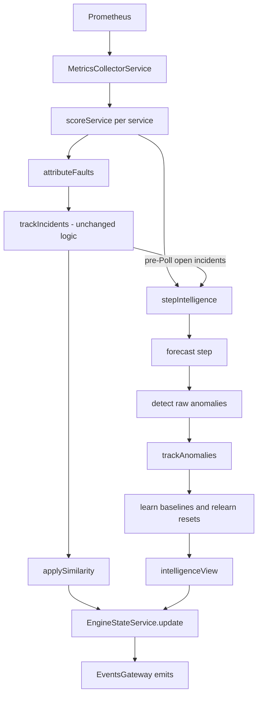
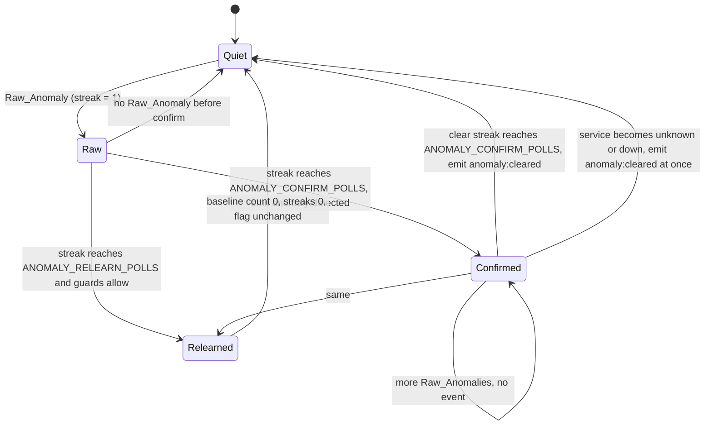
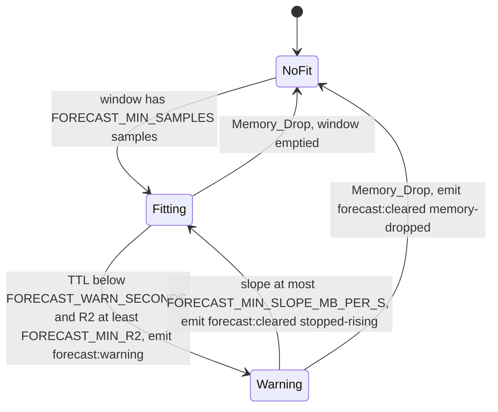

# Design Document

## Overview

engine-intelligence adds a small learned layer to the haunting-engine. It watches the same per-Poll data the engine already scores and produces three kinds of extra information:

1. **Anomalies.** An EWMA mean and variance per (service, signal) pair, a z-score test, a fixed-threshold fallback while the baseline warms up, and hysteresis before anything is reported.
2. **Memory forecasts.** A least-squares line through the last 15 RSS samples of each service, a time-to-limit estimate, and a warning with a clear reason.
3. **Similar incidents.** A numeric feature vector per Incident and a cosine-similarity lookup over resolved history, next to the existing Fingerprint recurrence.

None of this changes Health_Score, Service_Status, Breached_Kinds, Dread, attribution or the Incident lifecycle (R4.19, R9.7, R16.5). The new data is additive: two new `ClusterSnapshot` fields, one new `Incident` field and four new Socket.IO events, all defined once in `shared/`.

Design goals:

- **Pure core.** Every new decision is a pure function in `haunting-engine/src/intelligence/`. `PollerService` stays the only writer of engine state and calls the pure functions in a fixed order.
- **Replayable.** The only time source is the Poll timestamp. The same Poll sequence always yields the same state and events (R9.8).
- **Fail soft.** If an intelligence step throws, the Poll still stores and emits its snapshot with every pre-existing field unchanged (R9.6). A similarity failure sets one field to `null` (R8.14).
- **Honest about the demo.** The memory-leak lead-time test only works if the victim-app leak really grows RSS. Measuring the current leak showed that it does not (see "Findings that change the plan" below), so this design includes a victim-app fix, which Requirement 15, Criterion 10 now specifies.

### Findings that change the plan

Two things were found while reading the real code and checking the running stack. Both affect Requirements 14 and 15.

**F1. The existing victim-app memory leak does not grow RSS.** `ChaosService.enableMemoryLeak()` pushes `'x'.repeat(512 * 1024)` into `_leakArray`. V8 builds the result of `repeat` as a rope of shared cons-string nodes, so each "1 MB" entry costs a few bytes and is never flattened because nothing reads it. Measured on the running stack (not simulated):

| Check | Result |
|---|---|
| `POST /api/chaos/payments/memory-leak {enabled:true}` at the current 5 MB/s, sampled every 3 s for 18 s | `memoryLeakRetainedMb` went 15 → 90, `process_rss_bytes` stayed 85.4–86.0 MB |
| In the payments container (Node 20.20.2): 100 × `'x'.repeat(524288)` | +0.25 MB RSS, +0.05 MB heap |
| Local Node 23: 100 × `Buffer.alloc(1 MiB, 1)` | +100.4 MB RSS, +0.03 MB heap |

With this leak the engine would never see RSS rise, no forecast could appear, and the Requirement 14 test could not pass. The fix is small (allocate real, touched memory) and is specified in "Victim-app changes". Requirement 15, Criterion 10 specifies it, and Requirement 15, Criterion 8 carves it out of the rule that other Victim_App behavior stays unchanged.

**F2. A crash caused by the container memory limit is hard to observe through Requirement 14, Criterion 4.** The container limit is 256 MiB (`mem_limit: 256m`, cgroup `memory.max` = 268435456, confirmed in the payments container). The kernel kills the container when the whole cgroup reaches that limit, so process RSS never reaches `MEMORY_LIMIT_MB` = 256 in a sample. The only observable evidence is `up` equal to false or a large RSS drop after the restart. Earlier measurements already showed that a 1 to 3 s restart is missed by a 2 s scrape in 2 of 5 cases (haunting-engine design, Open Question 1). Requirement 14, Criterion 4 therefore includes a third crash signal, an RSS fall of more than `FORECAST_RESTART_DROP_MB` below the maximum RSS seen in the run (see "Integration test design").

---

## Architecture

### Where the new code sits



`stepIntelligence` and `applySimilarity` are independent: a throw in one does not affect the other (R8.14, R9.6).

### Per-Poll pipeline (exact order)

All of this happens inside `PollerService.poll(now)`. Items marked **(existing)** already exist and keep their behavior.

1. **(existing)** Collect signals. On `MetricsUnavailableError` the Poll is blind: every service is `unknown`, `metricsAvailable` is false.
2. **(existing)** Score every service, compute `dread`, build `byService`.
3. **(existing)** `attributeFaults` when not blind.
4. Capture `prevTracker = state.tracker` and `prevIntel = state.intelligence` **before** step 5. The Open_Incident guard for baselines and relearning reads `prevTracker.open`, which is the pre-Poll incident state (R2.7, R4.8).
5. **(existing)** `trackIncidents(prevTracker, …)` returns `tracker1` and `incidentEvents`.
6. **Intelligence step** (inside `try`), `stepIntelligence(prevIntel, input, config)`:
   1. If the Poll is blind, return `prevIntel` unchanged with no events (R2.1, R4.7, R5.9, R6.10).
   2. **Forecast step** for every service in chain order: Memory_Drop handling, RSS_Window update, Trend_Fit, Forecaster. Produces this Poll's Memory_Forecasts and forecast events (R9.9).
   3. Derive `leakSuspected[service]` from this Poll's Memory_Forecasts (R4.14). No anomaly state is read, so there is no cycle.
   4. **Detect** raw anomalies against the baselines as they were before this Poll (R3.1).
   5. Build one **observation** per (service, signal), testing in this order: `unknown-service` (status `unknown`), `down-service` (`signals.up` is false), `unusable` (value `null` or not finite), otherwise `evaluated`.
   6. **Track** streaks and confirmation; this returns events and the list of pairs to relearn (R4.2 to R4.16).
   7. **Learn**: apply the Poll value as one Baseline_Sample to every pair that passes all guards (R2.8).
   8. **Relearn reset** the pairs from step 6.
   9. Return the new state and the events, forecast events first, then anomaly events.
7. On a throw in step 6: log with stack, keep `prevIntel`, emit no `anomaly:*` or `forecast:*` events (R9.6).
8. `applySimilarity(tracker1, incidentEvents, now, …)` returns `tracker2` and `incidentEvents2`, each `opened` and `resolved` incident carrying its `similar` field. Failures are returned, not thrown, and the Poller logs them.
9. `intelligenceView(intel, chain)` yields the `anomalies` and `forecasts` snapshot fields from the state that will be stored. Blind Polls and the error fallback use the same function on the retained state, so the three cases cannot drift apart (R4.18, R6.10, R9.6).
10. Build the `ClusterSnapshot`, call `state.update(snapshot, tracker2, intel)`, then emit: snapshot, incident events, then forecast and anomaly events in the order the step returned them.

The forecast step runs before anomaly tracking (R9.9), and `Leak_Suspicion` is evaluated on the same-Poll forecasts. The pre-Poll open-incident state is used by detection-side guards and by relearning. The post-Poll incident state (`tracker2`) is used only by similarity.

### Module layout

```
haunting-engine/src/intelligence/
  intelligence-types.ts          # Baseline, PairTracking, RssSample, ServiceForecastState,
                                 #   IntelligenceState, IntelligenceEvent, PairObservation
  intelligence-step.ts           # initialIntelligenceState, stepIntelligence, intelligenceView
  intelligence-step.spec.ts
  intelligence-step.prop.spec.ts # pipeline-level properties (guards, blind, replay, purity)
  anomaly/
    baseline.ts                  # emptyBaseline, updateBaseline, resetBaseline, isWarmUp, stdDevOf
    baseline.prop.spec.ts
    anomaly-detector.ts          # zScore, detectAnomalies
    anomaly-detector.prop.spec.ts
    anomaly-learning.ts          # learnBaselines (all learning guards)
    anomaly-learning.prop.spec.ts
    anomaly-tracker.ts           # trackAnomalies (streaks, confirmation, relearn decision)
    anomaly-tracker.prop.spec.ts
  forecast/
    trend-fitter.ts              # fitTrend
    trend-fitter.prop.spec.ts
    forecaster.ts                # timeToLimitSeconds, stepForecast, isLeakSuspected
    forecaster.prop.spec.ts
  similarity/
    feature-extractor.ts         # extractFeatures, withoutDuration
    feature-extractor.prop.spec.ts
    similarity-matcher.ts        # cosineSimilarity, selectSimilar
    similarity-matcher.prop.spec.ts
    incident-similarity.ts       # matchOnOpen, matchOnResolve, applySimilarity
    incident-similarity.prop.spec.ts
```

Each `*.spec.ts` sits next to its source file (R9.5). There is no new Nest module: all new code is plain functions imported by `PollerService`. The state lives in the existing `EngineStateService`.

### Anomaly pair life cycle



A pair of a down or unknown service is cleared at once and keeps its Baseline. `Relearned` is not a stored state. The reset zeroes the baseline and both streaks and leaves `confirmed` as it was, so the diagram shows where the pair continues, not an extra flag.

### Forecast life cycle



---

## Components and Interfaces

Every function below is pure: no I/O, no timers, no clock reads, no module-level mutable state (R9.1). Inputs are never modified and every returned object is new (R9.2). Time comes in as `now` (epoch ms from the Poll).

### Configuration slices

`EngineConfig` (in `config/engine-config.ts`) gains four members. The pure functions take only the slice they need, so tests build small literals.

```ts
export interface AnomalyConfig {
  alpha: number;                                   // ANOMALY_ALPHA, (0, 1]
  zThreshold: number;                              // ANOMALY_Z_THRESHOLD, > 0
  warmupPolls: number;                             // ANOMALY_WARMUP_POLLS, integer >= 1
  confirmPolls: number;                            // ANOMALY_CONFIRM_POLLS, integer >= 1
  relearnPolls: number;                            // ANOMALY_RELEARN_POLLS, integer >= confirmPolls
  minStdDev: Record<MonitoredSignal, number>;      // ANOMALY_MIN_STDDEV_*, > 0
}

export interface ForecastConfig {
  windowPolls: number;                             // FORECAST_WINDOW_POLLS
  minSamples: number;                              // FORECAST_MIN_SAMPLES, <= windowPolls
  minR2: number;                                   // FORECAST_MIN_R2, [0, 1]
  minSlopeMbPerS: number;                          // FORECAST_MIN_SLOPE_MB_PER_S, > 0
  warnSeconds: number;                             // FORECAST_WARN_SECONDS, > 0
  restartDropMb: number;                           // FORECAST_RESTART_DROP_MB, > 0
}

export interface SimilarityConfig {
  threshold: number;                               // SIMILARITY_THRESHOLD, [0, 1]
  durationCapSeconds: number;                      // SIMILARITY_DURATION_CAP_SECONDS, integer >= 1
}

// added to EngineConfig:
//   memoryLimitMb: number;       // MEMORY_LIMIT_MB
//   anomaly: AnomalyConfig;
//   forecast: ForecastConfig;
//   similarity: SimilarityConfig;
```

`MonitoredSignal` is imported from `@haunted-cluster/shared`.

### Baselines (`anomaly/baseline.ts`)

```ts
export interface Baseline {
  readonly mean: number;
  readonly variance: number;
  readonly count: number;                          // Baseline_Samples applied so far
}

export const EMPTY_BASELINE: Baseline;             // { mean: 0, variance: 0, count: 0 }

/** R1.3 to R1.8. Non-finite or null sample returns the same Baseline. */
export function updateBaseline(b: Baseline, sample: number | null, alpha: number): Baseline;

/** R1.9. Returns EMPTY_BASELINE-equal value regardless of input. */
export function resetBaseline(b: Baseline): Baseline;

/** count < warmupPolls */
export function isWarmUp(b: Baseline, warmupPolls: number): boolean;

/** max(sqrt(variance), floor) */
export function effectiveStdDev(b: Baseline, floor: number): number;
```

Update rule (R1.3, R1.4): count 0 gives `{ mean: x, variance: 0, count: 1 }`; otherwise `mean' = m + α(x − m)`, `variance' = (1 − α)(v + α(x − m)²)`, `count' = count + 1`. The variance is clamped at 0 from below so rounding can never make it negative, and a non-finite result (possible only if the inputs were near `Number.MAX_VALUE`) returns the old Baseline, which keeps R1.6 true for every finite sample.

### Detection (`anomaly/anomaly-detector.ts`)

```ts
/** (x - mean) / effectiveStdDev. Finite, or null when x or the result is not finite. */
export function zScore(value: number, b: Baseline, floor: number): number | null;

export interface DetectionInput {
  health: Record<ServiceName, ServiceHealth>;      // signals, badness, status
  baselines: Record<ServiceName, Record<MonitoredSignal, Baseline>>;   // before this Poll's update
}

/**
 * Raw anomalies for one non-blind Poll, in chain order then signal order
 * (latencyP95Ms, errorRatio, rssMb). Unknown services, down services (`up` false) and non-finite values yield nothing.
 */
export function detectAnomalies(
  input: DetectionInput,
  config: AnomalyConfig,
  chain: readonly ServiceName[],
): AnomalyReading[];
```

Per (service, signal) with status not `unknown`, `signals.up` not false and a finite value `x`:

- Warm_Up (`count < warmupPolls`): flag only if the matching badness is greater than `BREACH_BADNESS` (0.2, imported from `health/health-scoring`). Method `fixed`, `zScore` null (R3.3, R3.4).
- Otherwise: `z = zScore(x, baseline, floor)`. Flag if `x > mean` and `z !== null && z > zThreshold`. Method `learned`. A fixed-threshold breach with `z <= zThreshold` is not flagged (R3.12). A value at or below the mean is never flagged (R3.5).

The signal-to-kind map is `latencyP95Ms → latency`, `errorRatio → errors`, `rssMb → memory`.

`AnomalyReading.baselineStdDev` carries the effective (floored) standard deviation, so a consumer can recompute `z = (value − baselineMean) / baselineStdDev`. During Warm_Up it carries the floored value of the current partial baseline (the floor alone for an empty baseline).

### Learning (`anomaly/anomaly-learning.ts`)

```ts
export interface LearningInput {
  metricsAvailable: boolean;
  health: Record<ServiceName, ServiceHealth>;
  observations: readonly PairObservation[];        // carries the raw flag of this Poll
  openBefore: Record<ServiceName, boolean>;        // pre-Poll Open_Incident per service
}

/** Applies the Poll value to every pair whose guards all pass; every other Baseline is returned unchanged. */
export function learnBaselines(
  baselines: BaselineMap,
  input: LearningInput,
  config: AnomalyConfig,
): BaselineMap;
```

A pair is guarded, and its Baseline is left as is, when any of these holds (R2.1 to R2.6):

| Guard | Condition |
|---|---|
| Blind | `metricsAvailable` is false |
| Unknown service | service status is `unknown` |
| Open incident | `openBefore[service]` is true (pre-Poll state, R2.7) |
| Unusable value | signal value is `null` or not finite |
| Down | `signals.up === false` |
| Raw anomaly | the pair has a Raw_Anomaly in this Poll (the unconfirmed flag, not the confirmed flag) |

Otherwise exactly one sample is applied (R2.8). The function never resets; resets are the tracker's decision.

### Tracking (`anomaly/anomaly-tracker.ts`)

```ts
export type PairObservation =
  | { service: ServiceName; signal: MonitoredSignal; kind: 'unknown-service' }
  | { service: ServiceName; signal: MonitoredSignal; kind: 'down-service' }           // up === false (Down_Service)
  | { service: ServiceName; signal: MonitoredSignal; kind: 'unusable' }          // null or non-finite value
  | { service: ServiceName; signal: MonitoredSignal; kind: 'evaluated'; reading: AnomalyReading | null };

export interface PairTracking {
  anomalousStreak: number;
  clearStreak: number;
  confirmed: boolean;
  lastReading: AnomalyReading | null;
}

export type TrackingMap = Record<ServiceName, Record<MonitoredSignal, PairTracking>>;

export type AnomalyEvent =
  | { type: 'anomaly:detected'; reading: AnomalyReading }
  | { type: 'anomaly:cleared'; service: ServiceName; signal: MonitoredSignal };

export interface TrackingContext {
  openBefore: Record<ServiceName, boolean>;        // pre-Poll Open_Incident
  leakSuspected: Record<ServiceName, boolean>;     // from this Poll's forecast step
}

export interface PairKey { service: ServiceName; signal: MonitoredSignal }

export function trackAnomalies(
  prev: TrackingMap,
  observations: readonly PairObservation[],
  context: TrackingContext,
  config: AnomalyConfig,
): { tracking: TrackingMap; events: AnomalyEvent[]; relearn: PairKey[] };
```

Rules, per observation (R4.2 to R4.16):

- `evaluated` with a reading: `anomalousStreak += 1`, `clearStreak = 0`, `lastReading = reading`.
- `evaluated` without a reading: `clearStreak += 1`, `anomalousStreak = 0`.
- `anomalousStreak === confirmPolls` and not confirmed: set confirmed, emit `anomaly:detected` with this Poll's reading. Because the streak can only equal `confirmPolls` once per run, a confirmed pair never re-emits (R4.6).
- `clearStreak === confirmPolls` and confirmed: clear the flag, emit `anomaly:cleared`. `lastReading` is dropped when the flag clears so the snapshot never shows a stale reading.
- `unknown-service` and `down-service` share one branch: both streaks 0, confirmed false, `lastReading` null; emit `anomaly:cleared` if it was confirmed (R4.10, R4.11). The pair is never added to `relearn`, and its Baseline is untouched (R2.2, R2.5). Two kinds exist only so that tests and logs can tell the cause apart; the observation builder tests `unknown-service` first.
- `unusable`: the pair is left exactly as it was, no event (R4.12). It applies only to a service that is neither unknown nor down.
- Relearn: if the pair is `evaluated`, `anomalousStreak >= relearnPolls`, `!openBefore[service]`, and not (`signal === 'rssMb'` and `leakSuspected[service]`), add the pair to `relearn` and set both streaks to 0 (R4.8, R4.9, R4.13 to R4.16). `confirmed` and `lastReading` are untouched by the reset. While a relearn is suppressed, the streak keeps counting with no cap (R4.15).

Events are ordered by chain order, then signal order. A pair with `confirmPolls` of 1 emits `detected` in its first anomalous Poll.

Edge case worth stating: with `relearnPolls === confirmPolls` (allowed by R11.9), `detected` and a relearn reset happen in the same Poll. The event is still emitted first and the reset leaves `confirmed` as true.

### Trend fitting (`forecast/trend-fitter.ts`)

```ts
export interface RssSample { readonly t: number; readonly mb: number }   // t = Poll epoch ms
export interface TrendFit { readonly slopeMbPerSecond: number; readonly r2: number }

export function fitTrend(window: readonly RssSample[], minSamples: number): TrendFit | null;
```

- Fewer than `minSamples` samples: `null` (R5.4).
- All timestamps equal: `null` (R5.6).
- Seconds are taken relative to the first sample, `x = (t − t0) / 1000`, and both axes are centered on their means before summing. This keeps the arithmetic accurate for epoch timestamps near 1.7e12 ms (R5.8 requires a relative tolerance of 1e-6).
- `slope = Sxy / Sxx`. `r2 = Sxy² / (Sxx · Syy)`, clamped to [0, 1]. If `Syy === 0` (all RSS equal) the result is `{ slope: 0, r2: 0 }` (R5.5).
- A non-finite slope or R² (extreme inputs) returns `null`, so R5.7 holds for every returned fit.

### Forecasting (`forecast/forecaster.ts`)

```ts
export interface ServiceForecastState {
  readonly window: readonly RssSample[];
  readonly warning: boolean;
  readonly forecast: MemoryForecast | null;        // last non-blind Poll; null when no fit and no warning
}

export interface RssObservation {
  service: ServiceName;
  now: number;
  up: boolean | null;
  rssMb: number | null;
}

export type ForecastEvent =
  | { type: 'forecast:warning'; forecast: MemoryForecast }
  | { type: 'forecast:cleared'; service: ServiceName; reason: ForecastClearReason };

/** (limit - latest) / slope, never below 0. Caller guarantees slope > 0. */
export function timeToLimitSeconds(latestRssMb: number, slope: number, limitMb: number): number;

export function stepForecast(
  prev: ServiceForecastState,
  obs: RssObservation,
  config: ForecastConfig,
  memoryLimitMb: number,
): { state: ServiceForecastState; event: ForecastEvent | null };

/** Leak_Suspicion: warning active, or fitted slope above the minimum slope, in this Poll's forecast. */
export function isLeakSuspected(forecast: MemoryForecast | null, config: ForecastConfig): boolean;
```

`stepForecast` order of operations for one service (R5, R6):

1. **Memory_Drop.** `previous` is the last sample in `prev.window`. A drop holds when `obs.up === false`, or `obs.rssMb` is finite and `previous !== undefined` and `previous.mb − obs.rssMb > restartDropMb`. On a drop: empty the window; if a warning was active, clear it with reason `memory-dropped` and emit `forecast:cleared`.
2. **Append.** If `up === true` and `rssMb` is finite, append `{ t: now, mb: rssMb }`, then drop the oldest samples until at most `windowPolls` remain. After a drop this starts the emptied window with the current sample (R6.6).
3. **Fit.** `fit = fitTrend(window, minSamples)`.
4. **Forecast.** If there is a fit: `latest = last sample`. `ttl = slope > minSlopeMbPerS ? timeToLimitSeconds(latest.mb, slope, memoryLimitMb) : null`.
5. **Warning start.** If no warning is active, `ttl !== null && ttl < warnSeconds && r2 >= minR2`: warning becomes active, emit `forecast:warning` (R6.2, R6.3, R6.8).
6. **Warning clear.** If a warning is active (it was active before this Poll and not cleared in step 1) and the fit exists with `slope <= minSlopeMbPerS`: clear with `stopped-rising` (R6.5).
7. **Result.** `forecast = fit ? { …, warning: warningAfterStep } : null`. A warning that is still active keeps its recomputed forecast in every snapshot (R6.4). A service with no fit and no warning has `forecast: null` (R6.9, R6.13).

A warning stays active until step 1 or step 6 clears it, even if R² later falls or the time to limit grows back above `warnSeconds`. This follows R6.4 and R6.5 literally.

If `rssMb` is `null` while `up` is `true`, no sample is appended and the window is not touched. The forecast is recomputed from the old window, so it repeats its last values. That case is listed under risks.

### Feature extraction (`similarity/feature-extractor.ts`)

```ts
export type FeatureVector = readonly number[];

/** 2N + 4 + 3 + 1 */
export function featureVectorLength(knownServiceCount: number): number;

export interface FeatureConfig {
  latencyCriticalMs: number;                       // config.latencyMs.critical
  errorRatioCritical: number;                      // config.errorRatio.critical
  memoryLimitMb: number;                           // config.memoryLimitMb
  durationCapSeconds: number;                      // config.similarity.durationCapSeconds
}

export function extractFeatures(
  incident: Incident,
  nowMs: number,
  chain: readonly ServiceName[],
  config: FeatureConfig,
): FeatureVector;

/** Builds the Comparison_Vector: drops the last entry (the duration). Used when comparing at open time (R8.6). */
export function withoutDuration(v: FeatureVector): FeatureVector;
```

Layout of the vector (R7.1), with `N = chain.length`:

| Index range | Content |
|---|---|
| `0 .. N-1` | one-hot Root_Service in chain order (all 0 if the root is not a Known_Service, R7.5) |
| `N .. 2N-1` | 1 for each Known_Service in `incident.affected`, else 0 |
| `2N .. 2N+3` | 1 or 0 for kinds `latency`, `errors`, `memory`, `down` |
| `2N+4 .. 2N+6` | peak latency / `latencyCriticalMs`, peak error ratio / `errorRatioCritical`, peak RSS / `memoryLimitMb`, each clamped to [0, 1], 0 for `null` (R7.2) |
| `2N+7` | duration seconds / `durationCapSeconds`, clamped to [0, 1] (R7.3) |

Duration seconds are `durationMs / 1000` for a resolved incident and `(nowMs − Date.parse(openedAt)) / 1000` for an open one (R7.4). The result depends only on the incident's content fields, never on `id`, `openedAt` or `resolvedAt` as identifiers (R7.7); `openedAt` matters only through the open-incident duration. Any non-finite intermediate becomes 0, so every entry is finite and in [0, 1] (R7.6).

### Cosine similarity and selection (`similarity/similarity-matcher.ts`)

```ts
export function cosineSimilarity(a: FeatureVector, b: FeatureVector): number;

export interface Candidate { incident: Incident; vector: FeatureVector }

export interface Match { incident: Incident; similarity: number }   // unrounded

export function selectSimilar(
  target: FeatureVector,
  candidates: readonly Candidate[],
  threshold: number,
): Match | null;
```

`cosineSimilarity` returns 0 for different lengths (never throws, R8.5), 0 when either norm is 0 (R8.4), otherwise `dot / (‖a‖‖b‖)` clamped to [0, 1]. The clamp only absorbs rounding such as 1.0000000000000002 for identical vectors (R8.1, R8.3). `selectSimilar` picks the highest similarity and, on a tie, the candidate with the latest `resolvedAt` (R8.7). It returns `null` when the best is below `threshold`, comparing the unrounded value (R8.8).

### Applying similarity to incidents (`similarity/incident-similarity.ts`)

```ts
export function toSimilarIncident(match: Match): SimilarIncident;   // rounds similarity to 3 dp

export function matchOnOpen(
  incident: Incident, history: readonly Incident[], nowMs: number,
  chain: readonly ServiceName[], config: EngineConfig,
): SimilarIncident | null;

export function matchOnResolve(
  incident: Incident, history: readonly Incident[],
  chain: readonly ServiceName[], config: EngineConfig,
): SimilarIncident | null;

export interface SimilarityFailure { incidentId: string; phase: 'open' | 'resolve'; error: unknown }

export function applySimilarity(
  tracker: TrackerState,
  events: readonly IncidentEvent[],
  nowMs: number,
  chain: readonly ServiceName[],
  config: EngineConfig,
): { tracker: TrackerState; events: IncidentEvent[]; failures: SimilarityFailure[] };
```

`applySimilarity` walks the events from the current Poll:

- `opened`: `similar = matchOnOpen(incident, tracker.history, …)`. Write the patched incident into `tracker.open[root]` and into the event.
- `resolved`: `similar = matchOnResolve(incident, tracker.history without this incident, …)`. Patch the entry with that id in `tracker.history` and the event.
- `updated`: untouched. The incident already carries `similar` because `trackIncidents` builds it from `state.open`, which was patched when it opened.

Each incident is wrapped in its own `try/catch`. On a throw the field is `null` and a `SimilarityFailure` is returned for the Poller to log with the stack (R8.14). The function never changes any other field of any incident (R8.13), and `Recurrence` is not touched (R8.12).

`tracker.history` here is the history after this Poll's tracker step, so incidents resolved in the same Poll are visible to an incident opening in that Poll, and two incidents resolving in the same Poll each see the other.

### The duration decision (R7.4)

**Decision (stated in R7.4 and R8.6): the duration entry is excluded from the cosine when an Incident is matched at open time, and included when it is matched at resolve time.** At open, the Comparison_Vector (the Feature_Vector without its duration entry) of the opening incident is compared with the Comparison_Vector of every candidate; `withoutDuration` builds it before `cosineSimilarity`. At resolve, the full Feature_Vectors are compared.

Why not leave the zero in:

- The opening incident has duration 0 because it has not lasted anything yet, not because it was short. A history incident with duration at the cap has an extra 1.0 in its vector, so the cosine drops even when everything else is identical.
- Worked example: an identical-shape memory incident with root one-hot 1 and the `memory` kind 1 (norm² 2 without duration). History incident has duration entry 1.0. Cosine with a zero-duration opener is `sqrt(2/3) = 0.816`, below `SIMILARITY_THRESHOLD` 0.85, so the match is missed. With a medium-size shape (norm² 4.34) it is 0.90, so whether a match appears would depend on how long the old incident ran. That is a bias against long incidents, the opposite of what a similarity lookup should do.

Why not weight the groups:

- A weight on the duration group (for example 0 at open and 1 at resolve) is the same thing in effect, but needs a weights argument in the matcher and a config knob nobody asked for. Dropping the last entry keeps the matcher signature at `(a, b)`, which is what R8.1 to R8.5 describe.

Consistency with R7 and R8:

- R7.1 to R7.8 hold: the extractor still returns the full vector of length `2N + 8`, with the duration entry computed under R7.3 and R7.4. R7.4 now states that the duration entry has no weight at open time and the same weight as other entries at resolve time.
- R8.1 to R8.5 hold for any pair of vectors, including shortened ones. Lengths always match because both sides are shortened together.
- R8.6 compares the Comparison_Vector of the opened Incident with the Comparison_Vectors of the resolved Incidents, which is what `matchOnOpen` does.
- R8.11 compares the full final Feature_Vector at resolve, which includes duration. Resolve is where duration is a known, comparable value. The recomputed field can differ from the open-time one, and that is intended: open time is a prediction from shape, resolve time is a comparison of the whole incident.
- `SIMILARITY_DURATION_CAP_SECONDS` still has an effect, at resolve time.

### Feature vector storage

Feature vectors are **derived on demand and not stored.** Everything the extractor needs (`rootService`, `affected`, `kinds`, `peak`, `durationMs`) is already on the resolved `Incident` held in `TrackerState.history` (at most `INCIDENT_HISTORY_LIMIT` = 50 entries, N is small). Recomputing 50 vectors of length about 14 per open or resolve is trivial, and a cache would add state to keep in step with history trimming. Deriving also makes R8.13 true by construction: nothing about a resolved incident is written when a similarity is computed. The cost is that configuration changes would change old vectors, but configuration is fixed for the life of a process and history is not persisted (out of scope).

### Intelligence state and view (`intelligence-step.ts`)

```ts
export function initialIntelligenceState(chain: readonly ServiceName[]): IntelligenceState;

export interface IntelligenceInput {
  now: number;
  metricsAvailable: boolean;
  health: Record<ServiceName, ServiceHealth>;
  openBefore: Record<ServiceName, boolean>;        // from the pre-Poll tracker state
}

export type IntelligenceEvent = ForecastEvent | AnomalyEvent;

export function stepIntelligence(
  prev: IntelligenceState,
  input: IntelligenceInput,
  config: EngineConfig,
): { state: IntelligenceState; events: IntelligenceEvent[] };

export function intelligenceView(
  state: IntelligenceState,
  chain: readonly ServiceName[],
): { anomalies: AnomalyReading[]; forecasts: MemoryForecast[] };
```

`intelligenceView` returns `anomalies` as the `lastReading` of every pair with `confirmed` true, in chain order then signal order (R4.17), and `forecasts` as the non-null `forecast` of every service in chain order (R6.13). It is the only place that turns state into snapshot fields.

### Wiring and emission

- `EngineStateService` gains `private intelligenceState`, a getter `intelligence`, and `update(snapshot, tracker, intelligence)`. The three are replaced together so a reader never sees a snapshot from one Poll and an intelligence state from another. `openIncidents()` and `resolvedIncidents()` are unchanged.
- `PollerService` keeps its constructor. It reads and writes the intelligence state through `EngineStateService`, so no provider changes. There are no new Nest providers, so the wiring test of R13.1 is the existing `app.module.spec.ts`, extended: it builds the real `AppModule`, calls `app.init()`, and asserts that the first stored snapshot has `anomalies` and `forecasts` fields.
- `EventsGateway` gains `emitIntelligenceEvent(event: IntelligenceEvent)`, which maps the internal event to the Socket.IO event name and payload with an exhaustive `switch`. `handleConnection` is unchanged: the latest snapshot already carries the current anomalies and forecasts (R10.9, R10.10).
- `incident-tracker.ts` gets one change: `openIncident` sets `similar: null` in the object it builds, because `Incident.similar` is a required field (R10.4). No decision logic in the tracker changes.

### Victim-app changes

**Memory gauge interval (R15.3 to R15.7).**

- `libs/common/src/env-validation.ts` gets a pure `parseMemoryGaugeIntervalMs(raw: string | undefined): number` that returns 1000 for `undefined` or an empty string, and otherwise requires the trimmed string to match `/^[1-9]\d*$/` and be a safe integer. Zero, negatives, fractions, non-numeric strings, `NaN` and `Infinity` all throw an `Error` naming `MEMORY_GAUGE_INTERVAL_MS`.
- A `validateMemoryGaugeInterval()` beside `validateRequiredEnv` calls the parser, logs `[Bootstrap] MEMORY_GAUGE_INTERVAL_MS … Exiting.` and calls `process.exit(1)` on error. Each app's `main.ts` calls it before `NestFactory.create`, including payments, which has no `validateRequiredEnv` call today.
- Both functions are exported from `libs/common/src/index.ts`.
- `MetricsService` reads `process.env.MEMORY_GAUGE_INTERVAL_MS` in its constructor through `parseMemoryGaugeIntervalMs` and uses the result in `setInterval`. `libs/observability` already imports `@app/common`, so there is no new dependency. The initial gauge refresh stays.
- `metrics.service.spec.ts`: the two tests that advance fake timers by `5_000` (names "after 5000ms interval fires" and "every 5000ms tick") change to `1_000`, and the comment on the constructor changes from 5 000 ms to the configured interval. New tests: default 1000, valid override, and one rejection per invalid class (`0`, `-5`, `1.5`, `abc`, `NaN`, `Infinity`).

**Leak rate (R15.1, R15.2, R15.7, R15.9).** `docker-compose.yml` sets `LEAK_MB_PER_SECOND: ${LEAK_MB_PER_SECOND:-2}` and `MEMORY_GAUGE_INTERVAL_MS: ${MEMORY_GAUGE_INTERVAL_MS:-1000}` on `gateway`, `orders` and `payments`. `victim-app/.env.example` lists `LEAK_MB_PER_SECOND=2` and `MEMORY_GAUGE_INTERVAL_MS=1000`, each with a one-line description. The code default in `chaos.service.ts` stays `'5'`.

**Real leak memory (finding F1; Requirement 15, Criterion 10, carved out of Criterion 8).** In `ChaosService.enableMemoryLeak()` the pushed entry changes from `'x'.repeat(ONE_MB_STRING_LENGTH)` to `Buffer.alloc(ONE_MB_BYTES, 1)` with `ONE_MB_BYTES = 1024 * 1024`. The fill value forces the pages to be touched, so they count as resident. The unit count (`LEAK_MB_PER_SECOND` per second) is unchanged. The array is still `unknown[]`, so `_leakArray.length`, `reset()`, TTL expiry and `getState()` behave as before and the existing tests that assert on array length keep passing. New tests: each entry is a `Buffer` of `1_048_576` bytes, and a test with real timers that enables the leak for about 3 ticks and asserts `process.memoryUsage().rss` grew by at least half of the nominal amount.

### Shared types

Everything below is added to `shared/src/` and re-exported from `index.ts`. New file `intelligence.ts` holds the anomaly, forecast and similarity types; `service-health.ts`, `incident.ts` and `events.ts` get the field and event additions.

```ts
// shared/src/intelligence.ts
import type { ServiceName } from './service-health';

/** The three signals the Engine learns a baseline for. */
export type MonitoredSignal = 'latencyP95Ms' | 'errorRatio' | 'rssMb';

/** How an anomaly was detected. */
export type AnomalyMethod = 'learned' | 'fixed';

/** One flagged signal. For a Confirmed_Anomaly this is the most recent reading of the pair. */
export interface AnomalyReading {
  service: ServiceName;
  signal: MonitoredSignal;
  /** The Poll value that was flagged. */
  value: number;
  /** Baseline mean when the Poll was evaluated. */
  baselineMean: number;
  /** Baseline standard deviation with the per-signal minimum applied. */
  baselineStdDev: number;
  /** (value - baselineMean) / baselineStdDev; null when method is 'fixed'. */
  zScore: number | null;
  method: AnomalyMethod;
}

/** Why a forecast warning ended. */
export type ForecastClearReason = 'stopped-rising' | 'memory-dropped';

/** Linear RSS trend of one service and the estimated time until the container memory limit. */
export interface MemoryForecast {
  service: ServiceName;
  /** MB per second from the least-squares fit. */
  slopeMbPerSecond: number;
  /** Coefficient of determination of the fit, 0-1. */
  r2: number;
  /** The most recent RSS sample in the fit, MB. */
  latestRssMb: number;
  /** Seconds until RSS reaches the limit; null when the slope is not above the minimum. */
  timeToLimitSeconds: number | null;
  /** True while a Forecast_Warning is active. */
  warning: boolean;
}

/** The resolved incident that looks most like another incident. */
export interface SimilarIncident {
  id: string;
  fingerprint: string;
  /** ISO 8601. */
  resolvedAt: string;
  /** Whole seconds, rounded from the matched incident's duration. */
  durationSeconds: number;
  /** Cosine similarity rounded to 3 decimal places, 0-1. */
  similarity: number;
}

export interface AnomalyClearedPayload {
  service: ServiceName;
  signal: MonitoredSignal;
}

export interface ForecastClearedPayload {
  service: ServiceName;
  reason: ForecastClearReason;
}
```

```ts
// shared/src/service-health.ts: ClusterSnapshot gains two fields
import type { AnomalyReading, MemoryForecast } from './intelligence';

export interface ClusterSnapshot {
  timestamp: string;
  metricsAvailable: boolean;
  services: ServiceHealth[];
  dread: number;
  /** Confirmed anomalies only, chain order then latencyP95Ms, errorRatio, rssMb. */
  anomalies: AnomalyReading[];
  /** One entry per service that has a trend fit or an active warning, chain order. */
  forecasts: MemoryForecast[];
}
```

```ts
// shared/src/incident.ts: Incident gains one field
import type { SimilarIncident } from './intelligence';

export interface Incident {
  // ...all existing fields unchanged...
  /** Most similar resolved incident by feature vector; null when none reaches the threshold. */
  similar: SimilarIncident | null;
}
```

```ts
// shared/src/events.ts: four events added to ServerToClientEvents
import type {
  AnomalyClearedPayload, AnomalyReading, ForecastClearedPayload, MemoryForecast,
} from './intelligence';

export interface ServerToClientEvents {
  // ...existing events unchanged...
  'anomaly:detected': (reading: AnomalyReading) => void;
  'anomaly:cleared': (payload: AnomalyClearedPayload) => void;
  'forecast:warning': (forecast: MemoryForecast) => void;
  'forecast:cleared': (payload: ForecastClearedPayload) => void;
}
```

`shared/src/index.ts` adds `export type * from './intelligence';`. The package still contains only type declarations and compiles with `emitDeclarationOnly` (R10.7). Every field is a finite number, a string, a boolean or `null`, never `undefined`, so JSON round-trips exactly (R10.8). Existing code that builds a `ClusterSnapshot` or an `Incident` literal (the poller, the tracker, and specs under `engine/`, `incidents/` and `test/`) must supply the new fields.

---

## Data Models

### Intelligence_State

```ts
export type BaselineMap = Record<ServiceName, Record<MonitoredSignal, Baseline>>;

export interface IntelligenceState {
  /** One Baseline per (service, signal): 3 x N entries (R1.1). */
  baselines: BaselineMap;
  /** Streaks, Confirmed_Anomaly flag and latest reading per pair (R4.1). */
  tracking: TrackingMap;
  /** RSS_Window, warning flag and last non-blind Memory_Forecast per service. */
  forecast: Record<ServiceName, ServiceForecastState>;
}
```

`initialIntelligenceState(chain)` returns, for every service: three `EMPTY_BASELINE` baselines, three `{ anomalousStreak: 0, clearStreak: 0, confirmed: false, lastReading: null }` tracking entries, and `{ window: [], warning: false, forecast: null }`. The Memory_Forecasts "of the last non-blind Poll" from the glossary are the `forecast.forecast` values. Nothing in the state is a `Map`, `Set` or class instance, so a state can be deep-compared and deep-frozen in tests.

Size: 3 baselines and 3 tracking entries per service, plus at most 15 samples per service. For a chain of N services the state holds about `6N + 15N` small objects.

### Configuration variables

All values are read in `loadEngineConfig` and nowhere else (R11.13). Defaults and rules are from R11.1 to R11.9.

| Variable | Config key | Default | Validation |
|---|---|---|---|
| `ANOMALY_ALPHA` | `anomaly.alpha` | 0.1 | finite, in (0, 1] |
| `ANOMALY_Z_THRESHOLD` | `anomaly.zThreshold` | 3 | finite, > 0 |
| `ANOMALY_WARMUP_POLLS` | `anomaly.warmupPolls` | 30 | positive integer |
| `ANOMALY_CONFIRM_POLLS` | `anomaly.confirmPolls` | 2 | positive integer |
| `ANOMALY_RELEARN_POLLS` | `anomaly.relearnPolls` | 30 | positive integer, >= `ANOMALY_CONFIRM_POLLS` |
| `ANOMALY_MIN_STDDEV_LATENCY_MS` | `anomaly.minStdDev.latencyP95Ms` | 5 | finite, > 0 |
| `ANOMALY_MIN_STDDEV_ERROR_RATIO` | `anomaly.minStdDev.errorRatio` | 0.005 | finite, > 0 |
| `ANOMALY_MIN_STDDEV_RSS_MB` | `anomaly.minStdDev.rssMb` | 2 | finite, > 0 |
| `MEMORY_LIMIT_MB` | `memoryLimitMb` | 256 | finite, > 0, > `MEMORY_CRITICAL_MB` |
| `FORECAST_WINDOW_POLLS` | `forecast.windowPolls` | 15 | positive integer |
| `FORECAST_MIN_SAMPLES` | `forecast.minSamples` | 5 | positive integer, <= `FORECAST_WINDOW_POLLS` |
| `FORECAST_MIN_R2` | `forecast.minR2` | 0.8 | finite, in [0, 1] |
| `FORECAST_MIN_SLOPE_MB_PER_S` | `forecast.minSlopeMbPerS` | 0.05 | finite, > 0 |
| `FORECAST_WARN_SECONDS` | `forecast.warnSeconds` | 60 | finite, > 0 |
| `FORECAST_RESTART_DROP_MB` | `forecast.restartDropMb` | 20 | finite, > 0 |
| `SIMILARITY_THRESHOLD` | `similarity.threshold` | 0.85 | finite, in [0, 1] |
| `SIMILARITY_DURATION_CAP_SECONDS` | `similarity.durationCapSeconds` | 300 | positive integer |

Test-only, read by the integration test and not by `loadEngineConfig`: `INTEGRATION_LEAK_TIMEOUT_SECONDS` (300) and `INTEGRATION_MIN_LEAD_SECONDS` (10), both positive integers.

**Validation mechanics.** The existing helpers (`finiteNumber`, `positiveInteger`) throw on the first bad variable. The new variables use a collecting loader so that R11.10 can name every offender:

- A helper `readIssues` parses each new variable and pushes `{ variable, message }` to an `issues` list instead of throwing. Unset or blank uses the default (the existing `read` helper already treats blank as unset).
- Cross rules run only when both sides parsed: `FORECAST_MIN_SAMPLES > FORECAST_WINDOW_POLLS` names `FORECAST_MIN_SAMPLES`; `MEMORY_LIMIT_MB <= memoryMb.critical` names `MEMORY_LIMIT_MB`; `ANOMALY_RELEARN_POLLS < ANOMALY_CONFIRM_POLLS` names `ANOMALY_RELEARN_POLLS`.
- If `issues` is not empty, throw one `ConfigError` whose `message` joins every issue (`"ANOMALY_ALPHA must be in (0, 1], got "2"; FORECAST_MIN_SAMPLES (10) must not exceed FORECAST_WINDOW_POLLS (5)"`). `ConfigError` keeps `variable` (the first offender, so existing callers and tests still work) and gains `readonly variables: string[]` with all of them.
- The existing parsing runs first, so a failure in an old variable still throws as before. `main.ts` prints `error.message`, which now names every new offender too, and exits 1.
- A process started with only the previously required variables gets every default (R13.4).

**`haunting-engine/.env.example`** gets this block (descriptions are one line each, as R11.11 requires):

```
# Anomaly baselines (EWMA mean/variance, z-score test)
# EWMA smoothing factor, in (0, 1]
ANOMALY_ALPHA=0.1
# Flag a signal when its z-score is above this
ANOMALY_Z_THRESHOLD=3
# Samples a baseline needs before it replaces the fixed thresholds
ANOMALY_WARMUP_POLLS=30
# Consecutive Polls before an anomaly is reported or cleared
ANOMALY_CONFIRM_POLLS=2
# Consecutive anomalous Polls (no open incident) before a baseline is relearned; >= ANOMALY_CONFIRM_POLLS
ANOMALY_RELEARN_POLLS=30
# Smallest standard deviation used for the z-score, per signal
ANOMALY_MIN_STDDEV_LATENCY_MS=5
ANOMALY_MIN_STDDEV_ERROR_RATIO=0.005
ANOMALY_MIN_STDDEV_RSS_MB=2

# Memory forecast
# Container memory limit in MB; must be greater than MEMORY_CRITICAL_MB
MEMORY_LIMIT_MB=256
# RSS samples kept per service for the trend fit
FORECAST_WINDOW_POLLS=15
# Samples needed before a trend is fitted; <= FORECAST_WINDOW_POLLS
FORECAST_MIN_SAMPLES=5
# Minimum R-squared of the fit to start a warning, 0-1
FORECAST_MIN_R2=0.8
# Slope (MB/s) at or below which memory counts as not rising
FORECAST_MIN_SLOPE_MB_PER_S=0.05
# Warn when the estimated time to the limit is below this many seconds
FORECAST_WARN_SECONDS=60
# An RSS fall larger than this many MB counts as a restart or freed leak
FORECAST_RESTART_DROP_MB=20

# Incident similarity
# Minimum cosine similarity (0-1) for a past incident to count as similar
SIMILARITY_THRESHOLD=0.85
# Incident duration (seconds) that maps to 1.0 in the feature vector
SIMILARITY_DURATION_CAP_SECONDS=300

# Integration test only (not read by the engine, not passed through docker-compose.yml)
# Give up waiting for the leaking payments service to crash after this many seconds
INTEGRATION_LEAK_TIMEOUT_SECONDS=300
# The forecast warning must come at least this many seconds before the crash
INTEGRATION_MIN_LEAD_SECONDS=10
```

**`docker-compose.yml`, `haunting-engine` service** adds, after `CORS_ORIGIN`:

```yaml
      ANOMALY_ALPHA: ${ANOMALY_ALPHA:-0.1}
      ANOMALY_Z_THRESHOLD: ${ANOMALY_Z_THRESHOLD:-3}
      ANOMALY_WARMUP_POLLS: ${ANOMALY_WARMUP_POLLS:-30}
      ANOMALY_CONFIRM_POLLS: ${ANOMALY_CONFIRM_POLLS:-2}
      ANOMALY_RELEARN_POLLS: ${ANOMALY_RELEARN_POLLS:-30}
      ANOMALY_MIN_STDDEV_LATENCY_MS: ${ANOMALY_MIN_STDDEV_LATENCY_MS:-5}
      ANOMALY_MIN_STDDEV_ERROR_RATIO: ${ANOMALY_MIN_STDDEV_ERROR_RATIO:-0.005}
      ANOMALY_MIN_STDDEV_RSS_MB: ${ANOMALY_MIN_STDDEV_RSS_MB:-2}
      MEMORY_LIMIT_MB: ${MEMORY_LIMIT_MB:-256}
      FORECAST_WINDOW_POLLS: ${FORECAST_WINDOW_POLLS:-15}
      FORECAST_MIN_SAMPLES: ${FORECAST_MIN_SAMPLES:-5}
      FORECAST_MIN_R2: ${FORECAST_MIN_R2:-0.8}
      FORECAST_MIN_SLOPE_MB_PER_S: ${FORECAST_MIN_SLOPE_MB_PER_S:-0.05}
      FORECAST_WARN_SECONDS: ${FORECAST_WARN_SECONDS:-60}
      FORECAST_RESTART_DROP_MB: ${FORECAST_RESTART_DROP_MB:-20}
      SIMILARITY_THRESHOLD: ${SIMILARITY_THRESHOLD:-0.85}
      SIMILARITY_DURATION_CAP_SECONDS: ${SIMILARITY_DURATION_CAP_SECONDS:-300}
```

and for each of `gateway`, `orders`, `payments`, the two lines `LEAK_MB_PER_SECOND: ${LEAK_MB_PER_SECOND:-2}` (replacing `5`) and `MEMORY_GAUGE_INTERVAL_MS: ${MEMORY_GAUGE_INTERVAL_MS:-1000}`. `mem_limit`, healthchecks and `CHAOS_TTL_SECONDS` stay as they are.

### REST and snapshot shape

`GET /api/snapshot` returns the stored `ClusterSnapshot` including `anomalies` and `forecasts`. `GET /api/incidents` returns incidents with `similar`. `incident:list` on connect carries open incidents with `similar`. No route is added or renamed (R9.7).


---

## Correctness Properties

*A property is a characteristic or behavior that should hold true across all valid executions of a system-essentially, a formal statement about what the system should do. Properties serve as the bridge between human-readable specifications and machine-verifiable correctness guarantees.*

### Property 1: Initial state shape

*For any* Service_Chain of N services, `initialIntelligenceState` SHALL hold exactly 3 × N Baselines, each with count 0, mean 0 and variance 0; every pair tracking entry SHALL have streaks 0, `confirmed` false and `lastReading` null; and every service SHALL have an empty window, no warning and a `null` forecast.

**Validates: Requirements 1.1, 1.2, 4.1**

### Property 2: Baseline update rule and invariants

*For any* Baseline with finite fields and variance ≥ 0, any finite sample `x` and any `alpha` in (0, 1], `updateBaseline` SHALL return a new Baseline whose count is exactly one more than before, whose mean and variance are finite, whose variance is ≥ 0, and which equals `{ x, 0, 1 }` when the input count was 0 and `{ m + α(x − m), (1 − α)(v + α(x − m)²), count + 1 }` otherwise (within floating-point tolerance); the input Baseline SHALL be deeply equal before and after, and calling twice SHALL give deeply equal results.

**Validates: Requirements 1.3, 1.4, 1.5, 1.6, 1.7**

### Property 3: Non-finite samples change nothing

*For any* Baseline and any sample that is `null`, `NaN`, `Infinity` or `-Infinity`, `updateBaseline` SHALL return a Baseline deeply equal to the input.

**Validates: Requirements 1.8**

### Property 4: Reset behaves like a fresh baseline

*For any* Baseline, any finite sample `x` and any `alpha`, `resetBaseline` SHALL return `{ mean: 0, variance: 0, count: 0 }`, and `updateBaseline(resetBaseline(b), x, alpha)` SHALL equal `{ mean: x, variance: 0, count: 1 }`.

**Validates: Requirements 1.9, 1.3**

### Property 5: Guarded pairs keep their Baseline

*For any* set of Baselines, health snapshot, observations, pre-Poll open-incident map and `metricsAvailable` flag, `learnBaselines` SHALL return, for every pair to which at least one guard applies (blind Poll, unknown service, pre-Poll Open_Incident, `null` or non-finite value, `up` false, or a Raw_Anomaly in this Poll evaluated on the unconfirmed flag), a Baseline deeply equal to the input Baseline, and SHALL never reset a Baseline.

**Validates: Requirements 2.1, 2.2, 2.3, 2.4, 2.5, 2.6, 2.9**

### Property 6: Baselines equal a replay of the unguarded Polls

*For any* generated Poll sequence containing Blind_Polls, Unknown_Services, Open_Incidents, `null` values and anomalous values, the Baselines after running the full pipeline SHALL equal the Baselines obtained by starting from the initial state and applying `updateBaseline` only for the (Poll, pair) combinations to which no learning guard applies and which were not relearn-reset, each exactly once.

**Validates: Requirements 2.8, 2.9**

### Property 7: Open-incident guard reads the pre-Poll state

*For any* Poll sequence, in a Poll where a service has no Open_Incident before incident tracking and one opens during that Poll, the service's unflagged signals SHALL still be learned in that Poll; and in a Poll where its Open_Incident resolves, they SHALL NOT be learned.

**Validates: Requirements 2.7**

### Property 8: Z-scores are finite or null and respect the floor

*For any* Baseline, finite value and per-signal floor > 0, `zScore` SHALL return a finite number or `null`, SHALL equal `(x − mean) / max(sqrt(variance), floor)` when finite, and every `AnomalyReading` from `detectAnomalies` SHALL carry a finite `zScore` or `null` and a `baselineStdDev` ≥ the floor of its signal.

**Validates: Requirements 3.6, 3.10**

### Property 9: Warm-up flags only fixed-threshold breaches

*For any* Poll where a pair's Baseline count is below `warmupPolls`, `detectAnomalies` SHALL flag that pair if and only if the matching Badness is greater than 0.2, and every such reading SHALL have method `fixed` and `zScore` `null`.

**Validates: Requirements 3.3, 3.4**

### Property 10: Learned flagging rule after warm-up

*For any* pair whose Baseline count is at least `warmupPolls` and any finite value, `detectAnomalies` SHALL flag the pair with method `learned` if and only if the value is greater than the mean and its z-score is greater than `zThreshold`, regardless of whether the value is a Fixed_Threshold_Breach; a value at or below the mean SHALL never be flagged.

**Validates: Requirements 3.2, 3.5, 3.12**

### Property 11: Nothing evaluable, nothing flagged

*For any* input, `detectAnomalies` SHALL return no reading for a pair whose service is unknown or down (`up` false) or whose value is `null`, `NaN` or infinite, and `stepIntelligence` SHALL feed the tracker nothing in a Blind_Poll.

**Validates: Requirements 3.1, 3.7, 3.8, 3.9**

### Property 12: Confirmation and clearing events fire once, at the right Poll

*For any* sequence of evaluated observations for one pair and any `confirmPolls` ≥ 1, `trackAnomalies` SHALL emit `anomaly:detected` exactly in the Poll where the Anomalous_Streak first reaches `confirmPolls` while the pair is not confirmed, carrying that Poll's reading, SHALL emit `anomaly:cleared` exactly in the Poll where the Clear_Streak first reaches `confirmPolls` while the pair is confirmed, SHALL emit nothing for a run shorter than `confirmPolls`, SHALL never emit `detected` for a confirmed pair or `cleared` for an unconfirmed pair, and SHALL keep each streak equal to the length of the current run.

**Validates: Requirements 4.2, 4.3, 4.4, 4.5, 4.6**

### Property 13: Blind Polls change nothing

*For any* Poll sequence and any positions at which Blind_Polls are inserted, the Intelligence_State after each Blind_Poll SHALL be deeply equal to the state before it, no `anomaly:*` or `forecast:*` event SHALL be emitted in it, its `intelligenceView` SHALL equal that of the last non-blind Poll (or two empty lists when there was none), and the final state SHALL equal the state of the sequence without the Blind_Polls.

**Validates: Requirements 4.7, 4.18, 5.9, 6.10**

### Property 14: Unknown and down services clear at once and unusable values freeze the pair

*For any* tracking state, an `unknown-service` or a `down-service` observation SHALL set both streaks to 0, `confirmed` to false and `lastReading` to `null`, SHALL emit `anomaly:cleared` exactly when the pair was confirmed, and SHALL never put the pair in `relearn`; an `unusable` observation SHALL leave the pair deeply equal and emit nothing. At pipeline level, in any non-blind Poll in which a service has `up` false, `intelligenceView(state).anomalies` SHALL contain no reading of that service afterwards, and the Baselines of that service SHALL be deeply equal to those before the Poll.

**Validates: Requirements 2.5, 4.10, 4.11, 4.12, 4.17**

### Property 15: Relearn happens in exactly the first eligible Poll

*For any* Poll sequence, a pair SHALL be relearn-reset in a Poll if and only if its Anomalous_Streak including that Poll is at least `relearnPolls`, the service had no Open_Incident before the Poll's incident step, and the pair is not suppressed by Leak_Suspicion; after the reset the Baseline count SHALL be 0, both streaks SHALL be 0, and `confirmed` and `lastReading` SHALL be unchanged; while the service has an Open_Incident the streaks SHALL keep updating and no reset SHALL occur.

**Validates: Requirements 4.8, 4.9, 4.13**

### Property 16: A suspected leak is never relearned as normal

*For any* Poll sequence, no relearn reset of the `rssMb` Baseline of a service SHALL occur in a Poll in which that service's Memory_Forecast from the same Poll has an active warning or a slope above `minSlopeMbPerS`; during the suppression the Anomalous_Streak SHALL keep counting without a cap, the reset SHALL occur in the first non-blind Poll in which Leak_Suspicion has ended and the other relearn conditions hold, and the relearn decisions for `latencyP95Ms` and `errorRatio` of the same service and for every signal of other services SHALL not depend on Leak_Suspicion.

**Validates: Requirements 4.14, 4.15, 4.16, 9.9**

### Property 17: Reported anomalies are exactly the confirmed ones, in order

*For any* Intelligence_State, `intelligenceView(state).anomalies` SHALL contain the `lastReading` of every pair with `confirmed` true and no other reading, ordered by chain position and then `latencyP95Ms`, `errorRatio`, `rssMb`; a pair that is only a Raw_Anomaly SHALL not appear.

**Validates: Requirements 4.17**

### Property 18: Existing decisions do not depend on the intelligence layer

*For any* Poll sequence, the `ServiceHealth` list, `dread`, attributions, incident ids, kinds, affected services, fingerprints, `recurrence`, `relatedChaos`, statuses and events produced by `trackIncidents` followed by `applySimilarity` SHALL equal those produced by `trackIncidents` alone once the `similar` field is ignored; `applySimilarity` SHALL change the `similar` field only of incidents that open or resolve in that Poll, and no field of any other incident in `open` or `history`.

**Validates: Requirements 4.19, 8.12, 8.13, 9.7**

### Property 19: The RSS_Window follows its update rule

*For any* sequence of observations `(now, up, rssMb)` with increasing `now`, after `stepForecast` the window SHALL hold at most `windowPolls` samples in time order; a sample SHALL be appended exactly when `up` is true and `rssMb` is finite; a service with an Open_Incident SHALL be updated like any other; and the window SHALL be empty after a Memory_Drop unless that same observation appended a sample, in which case it SHALL hold exactly that sample.

**Validates: Requirements 5.1, 5.2, 5.10, 6.6**

### Property 20: The trend fit recovers an exact line

*For any* window of at least `minSamples` samples whose values lie on `a + b·t` (t in seconds, increasing timestamps, including epoch-millisecond magnitudes), `fitTrend` SHALL return a slope equal to `b` and an R² equal to 1 within a relative tolerance of 1e-6.

**Validates: Requirements 5.3, 5.8**

### Property 21: Trend fits are well formed

*For any* window, `fitTrend` SHALL return `null` when it holds fewer than `minSamples` samples or all timestamps are equal; otherwise it SHALL return a finite slope and an R² in [0, 1], and SHALL return slope 0 and R² 0 when all RSS values are equal.

**Validates: Requirements 5.4, 5.5, 5.6, 5.7**

### Property 22: Time to limit is null or a finite non-negative number

*For any* window and configuration, the `timeToLimitSeconds` of the resulting Memory_Forecast SHALL be `null` when the slope is not above `minSlopeMbPerS` and otherwise SHALL equal `max(0, (limit − latest) / slope)`, which is finite and ≥ 0; a service with no fit and no warning SHALL have a `null` forecast.

**Validates: Requirements 6.1, 6.9, 6.11**

### Property 23: Time to limit is monotonic

*For any* positive slope and latest RSS, `timeToLimitSeconds` SHALL not increase when the latest RSS increases with the slope held fixed, and SHALL not increase when the slope increases with the latest RSS held fixed.

**Validates: Requirements 6.12**

### Property 24: Warnings start only from a good, close fit

*For any* observation sequence and configuration, `stepForecast` SHALL start a warning, and emit exactly one `forecast:warning` carrying the Memory_Forecast, if and only if no warning was active, a fit exists, the time to limit is below `warnSeconds` and R² is at least `minR2`; a fit with R² below `minR2` SHALL never start a warning.

**Validates: Requirements 6.2, 6.3, 6.8**

### Property 25: An active warning stays visible and silent

*For any* observation sequence, while a warning is active the service's forecast SHALL be the one recomputed in the current Poll with `warning` true, no further `forecast:warning` SHALL be emitted for it, and `intelligenceView(state).forecasts` SHALL contain one forecast for exactly the services with a fit or an active warning, in chain order.

**Validates: Requirements 6.4, 6.13**

### Property 26: Warnings clear with the right reason, once

*For any* observation sequence with an active warning, `stepForecast` SHALL emit exactly one `forecast:cleared` with reason `memory-dropped` in a Poll with a Memory_Drop (`up` false, or an RSS fall larger than `restartDropMb`), SHALL emit exactly one with reason `stopped-rising` in a Poll without a Memory_Drop whose fitted slope is at most `minSlopeMbPerS`, and SHALL emit none otherwise or when no warning was active.

**Validates: Requirements 6.5, 6.6, 6.7**

### Property 27: Feature vectors have the specified shape and range

*For any* Service_Chain of N services and any Incident (including a Root_Service outside the chain, `null` peaks, and peaks above their critical values), `extractFeatures` SHALL return a vector of length 2N + 8 whose entries are finite and lie in [0, 1], with the one-hot, affected and kind groups matching the Incident, the peak entries equal to the clamped ratio of each peak to its critical value (0 for `null`), the duration entry equal to the clamped ratio of the duration to the cap, and an all-zero one-hot group when the root is unknown.

**Validates: Requirements 7.1, 7.2, 7.3, 7.5, 7.6**

### Property 28: Feature vectors depend on content, not identity, and open duration starts at 0

*For any* two Incidents with the same Root_Service, affected services, kinds, peaks and duration but different ids and timestamps, `extractFeatures` SHALL return equal vectors; for an open Incident the duration entry SHALL be 0 when `now` equals its open time and SHALL not decrease as `now` increases; calling twice SHALL give equal vectors and leave the Incident deeply equal.

**Validates: Requirements 7.4, 7.7, 7.8**

### Property 29: Cosine similarity laws

*For any* Feature_Vectors `a` and `b` with non-negative entries, `cosineSimilarity` SHALL be finite and in [0, 1] when the lengths are equal, SHALL satisfy `cos(a, b) = cos(b, a)`, SHALL be 1 within 1e-9 for `(a, a)` when `a` is non-zero, SHALL be 0 when either norm is 0, and SHALL be 0 without throwing when the lengths differ.

**Validates: Requirements 8.1, 8.2, 8.3, 8.4, 8.5**

### Property 30: The best candidate wins, ties go to the latest, and the threshold decides

*For any* target vector, candidate list and threshold, `selectSimilar` SHALL return the candidate with the highest unrounded cosine similarity, SHALL break exact ties in favor of the latest `resolvedAt`, SHALL return `null` when the list is empty or the best similarity is below the threshold, and any returned match SHALL have a similarity ≥ threshold.

**Validates: Requirements 8.7, 8.8, 8.10**

### Property 31: Matching at open time ignores durations

*For any* opening Incident, history and `now`, the result of `matchOnOpen` SHALL be unchanged when the `durationMs` of every history Incident is replaced by any other value, and SHALL be unchanged when `now` changes; and for an Incident whose shape equals a history Incident's, `matchOnOpen` SHALL return that history Incident with similarity 1.

**Validates: Requirements 8.6, 7.4**

### Property 32: Matching at resolve time excludes the incident itself and reports a well-formed record

*For any* resolving Incident and history, `matchOnResolve` SHALL never return the Incident's own id, SHALL compare the full vector including duration, and any returned `SimilarIncident` SHALL carry the matched Incident's id, fingerprint, `resolvedAt`, duration in whole seconds, and similarity rounded to 3 decimal places; `applySimilarity` SHALL place the recomputed field on the `incident:resolved` event and on the history entry.

**Validates: Requirements 8.9, 8.11**

### Property 33: Everything is pure and replayable

*For any* generated Poll sequence (with deep-frozen inputs and states), running `stepIntelligence` and `applySimilarity` SHALL not throw on frozen arguments, SHALL leave every argument deeply equal to its copy from before the call, and running the same sequence twice SHALL produce deeply equal final states and deeply equal event lists, with no use of wall-clock time.

**Validates: Requirements 3.11, 5.11, 7.8, 9.1, 9.2, 9.8**

### Property 34: Snapshots and incidents survive a JSON round trip

*For any* Poll sequence, every `ClusterSnapshot` and `Incident` the pipeline produces SHALL satisfy `JSON.parse(JSON.stringify(x))` deeply equal to `x`, with no `NaN`, `Infinity` or `undefined` in any new field.

**Validates: Requirements 10.8**

### Property 35: Only positive integers are accepted as a gauge interval

*For any* string that is not a positive integer (zero, negatives, fractions, non-numeric text, `NaN`, `Infinity`), `parseMemoryGaugeIntervalMs` SHALL throw an error naming `MEMORY_GAUGE_INTERVAL_MS`; for any positive integer string it SHALL return that integer; for `undefined` or an empty string it SHALL return 1000.

**Validates: Requirements 15.3, 15.4, 15.5**

---

## Error Handling

| Condition | Behavior |
|---|---|
| Invalid new env variable at startup | `loadEngineConfig` throws one `ConfigError` naming every offending variable; `main.ts` logs `[Bootstrap] … Exiting.` and exits 1 (R11.3 to R11.10) |
| Invalid `MEMORY_GAUGE_INTERVAL_MS` in a victim service | `validateMemoryGaugeInterval` logs an error naming it and exits 1 before the app listens (R15.5) |
| Blind Poll (Prometheus unavailable) | `stepIntelligence` returns the previous state and no events; snapshot carries `anomalies` and `forecasts` from that state (R4.17, R6.10) |
| `stepIntelligence` throws | Poller logs `Intelligence step failed: <message>` with the stack, keeps the previous Intelligence_State, emits no `anomaly:*` or `forecast:*` events, and still stores and emits the snapshot with pre-existing fields unchanged (R9.6) |
| `matchOnOpen` or `matchOnResolve` throws for one incident | `similar` is `null`; `applySimilarity` returns a `SimilarityFailure`; Poller logs it with the stack; the incident still opens or resolves and its event is emitted (R8.14) |
| `PollerService` fails outside both steps | Unchanged: existing handler in `tick()` logs the error and the loop continues |
| Non-finite signal value | Treated as unusable: no sample, no flag, pair state frozen for an up service (R2.4, R3.7, R4.12) |
| `cosineSimilarity` given vectors of different length | Returns 0, never throws (R8.5) |
| `fitTrend` given equal timestamps or non-finite results | Returns `null`, so no forecast is produced |
| Service is `unknown` while metrics are available | Anomaly pairs clear at once (R4.10); the RSS_Window and any warning are left as they were (R5.2 only skips the sample) |
| Service has `up` false in a non-blind Poll | Anomaly pairs clear at once, exactly as for an unknown service (R4.11); Baselines unchanged (R2.5); the forecast step handles it as a Memory_Drop (R6.6) |
| Duplicate or non-increasing Poll timestamps | A window with all-equal timestamps yields no fit; mixed windows fit normally. The Poller's clock is monotonic in practice, so this is defensive only |

The two intelligence try/catch blocks are separate on purpose: a bug in similarity cannot freeze anomaly detection, and a bug in forecasting cannot drop similar-incident data. Nothing is swallowed: every catch logs the error with its stack (tech.md rule).

---

## Testing Strategy

### Why property-based testing applies

The new logic is pure functions over numbers and plain records: EWMA updates, z-scores, a regression, a cosine, and reducers over Poll sequences. Behavior varies a lot with input and 100 random iterations find real edge cases (zero variance, equal timestamps, flat RSS). PBT therefore applies to the core. It does not apply to config loading, the Nest wiring, the file edits to compose and `.env.example`, the Socket.IO emission, or the integration test; those use example-based and integration tests.

### Merged acceptance criteria

The correctness properties merge acceptance criteria that say the same thing. The merges, decided before writing the list:

- R1.1 and R1.2 (initial state) and R4.1 (initial tracking) are one statement about `initialIntelligenceState`, so they are one property.
- R1.3 to R1.7 all describe the one update rule and merge into one property. R1.8 (non-finite no-op) and R1.9 (reset) stay separate because they have different inputs and are cheap to read.
- R2.1 to R2.6 and R2.9 are the same shape ("this guard applies, so nothing changes") and merge into one property with a guard generator. R2.8 and R12.4 are the converse and become the replay-equivalence property. R2.7 needs the pipeline and the incident state, so it is separate.
- R3.2, R3.5 and R3.12 merge (the learned rule). R3.3 and R3.4 merge (the warm-up rule). R3.7 to R3.9 merge ("no reading when nothing is evaluable"). R3.6 and R3.10 merge (floor and finite z-score).
- R4.2 to R4.6 merge into one event-timing property. R4.8, R4.9 and R4.13 merge (relearn decision). R4.14 to R4.16 merge (leak suppression). R4.10 to R4.12 merge (unknown, down and unusable pairs).
- R4.7, R4.18, R5.9 and R6.10 are all "a blind Poll changes nothing", one property.
- R5.1, R5.2 and R5.10 merge. R5.4 to R5.7 merge. R5.3 and R5.8 merge.
- R6.5 to R6.7 merge into one clear-reason property. R6.2, R6.3 and R6.8 merge. R6.4 and R6.13 merge.
- R3.11, R5.11, R7.8, R9.1, R9.2 and R9.8 all say "pure and replayable" and merge into one property over generated Poll sequences with deep-frozen inputs.
- R4.19, R8.12, R8.13 and R9.7 merge into the "existing decisions are unaffected" property.
- Not properties (examples, integration or documentation): R8.14, R9.3 to R9.7, R10.1 to R10.7, R10.9, R10.10, R11, R12, R13, R14, R15 (except R15.5), R16.

### Property-based tests (fast-check 3.20.0)

Every property above is one `fc.assert(fc.property(...))` with `{ numRuns: 100 }` or more and a tag comment directly above it in the form `// Feature: engine-intelligence, Property <N>: <text>` (R12.2). Property numbers are unique across the feature.

| Properties | File | Main generators |
|---|---|---|
| 1, 6, 7, 13, 16, 33, 34 | `intelligence/intelligence-step.prop.spec.ts` | Poll sequences of 1–60 Polls over chains of 1–4 services; per Poll: blind flag, per-service status, signal values mixing normal, anomalous, `null`, `NaN`; open-incident map; RSS ramps and drops |
| 2, 3, 4 | `anomaly/baseline.prop.spec.ts` | finite doubles in ±1e9, alpha `fc.double({min: 1e-6, max: 1, noNaN: true})`, non-finite constants |
| 5 | `anomaly/anomaly-learning.prop.spec.ts` | baselines with random counts, one chosen guard per case |
| 8, 9, 10, 11 | `anomaly/anomaly-detector.prop.spec.ts` | baselines on both sides of `warmupPolls`, values around mean ± k·stddev |
| 12, 14, 15, 17 | `anomaly/anomaly-tracker.prop.spec.ts` | observation runs of length 1–80, random `confirmPolls` and `relearnPolls` (≥ confirm) |
| 19, 22, 24, 25, 26 | `forecast/forecaster.prop.spec.ts` | RSS series: ramps with noise, flats, falls above and below `restartDropMb`, `up` flips, `null` values |
| 20, 21 | `forecast/trend-fitter.prop.spec.ts` | exact lines with epoch-ms timestamps, random noise, degenerate windows |
| 23 | `forecast/forecaster.prop.spec.ts` | positive slope and RSS pairs |
| 27, 28 | `similarity/feature-extractor.prop.spec.ts` | incidents with 0–N affected, any kinds subset, peaks from `fc.option(fc.double())` including values far above critical |
| 29, 30 | `similarity/similarity-matcher.prop.spec.ts` | non-negative vectors of equal and unequal lengths, duplicates for tie-breaking |
| 18, 31, 32 | `similarity/incident-similarity.prop.spec.ts` | tracker sequences from the existing incident-tracker generators plus histories of 0–50 resolved incidents |
| 35 | `victim-app/libs/common/src/env-validation.prop.spec.ts` | `fc.string()`, `fc.integer()` mapped to strings, constants `'NaN'`, `'Infinity'`, `'-1'`, `'1.5'` |

Pipeline properties build their sequences with a small test helper, `intelligence/test-support.ts`, that builds `ServiceHealth` records through the real `scoreService` so the Fixed_Threshold_Breach logic is the production one. The helper also exposes `deepFreeze`.

Property 6 uses an independent reference model inside the test: a plain loop that applies `updateBaseline` for the pairs a straightforward restatement of the guards allows. Property 33 freezes inputs with `deepFreeze` and compares two replays with `toEqual`.

### Unit and example tests

- **`loadEngineConfig` (R12.5):** one test asserts every default of R11.1 (including `ANOMALY_CONFIRM_POLLS` 2, `ANOMALY_RELEARN_POLLS` 30, `FORECAST_WINDOW_POLLS` 15, `FORECAST_MIN_SAMPLES` 5); one test per rejection rule of R11.3 to R11.9, each asserting the thrown `ConfigError` names the variable (including `ANOMALY_RELEARN_POLLS` < `ANOMALY_CONFIRM_POLLS`); a test with three violations asserting all three names are in the message (R11.10); a test that the old variable set alone still loads (R13.4); a test that `LEAK_MB_PER_SECOND` and `MEMORY_GAUGE_INTERVAL_MS` are not read (R11.14).
- **File checks (R11.11, R11.12, R15.1, R15.2, R15.7):** a spec parses `haunting-engine/.env.example`, `victim-app/.env.example` and `docker-compose.yml` and asserts every variable is listed with the documented default, that compose uses `${NAME:-default}` with matching defaults, and that the two `INTEGRATION_*` variables are in `.env.example` but not in compose.
- **`PollerService` (existing spec extended):** the call order (forecast before tracking, pre-Poll incident state passed), an injected throw in `stepIntelligence` (state kept, snapshot emitted with `anomalies` and `forecasts` from the retained state, no intelligence events, R9.6), a throw in similarity (`similar` null, event still emitted, error logged, R8.14), event emission order, and that a Blind_Poll snapshot repeats the previous `anomalies` and `forecasts`.
- **`EventsGateway`:** `emitIntelligenceEvent` maps each of the four internal events to the right Socket.IO name and payload; a connecting client still gets the latest snapshot, now with `anomalies` and `forecasts` (R10.9).
- **`AppModule` (R13.1):** the existing `app.module.spec.ts` is extended. It builds the real `AppModule` (no new providers), calls `app.init()`, and asserts that the first stored snapshot has `anomalies: []` and `forecasts: []`.
- **Worked examples:** a replay of a scripted leak (flat 85 MB for 10 Polls, then +4 MB per 2 s Poll) asserting the warning appears on the expected Poll and the `rssMb` baseline is not relearned; a latency spike that confirms after two Polls and clears after two; a payments restart sequence (`up` false for one Poll) asserting `memory-dropped`, `anomaly:cleared` for every confirmed payments pair in that same Poll, and unchanged payments Baselines; and a flapping sequence (`up` alternating false and true) asserting one `detected` and one `cleared` per cycle only when `confirmPolls` anomalous Polls separate the outages.
- **Victim-app:** `metrics.service.spec.ts` updated from 5000 ms to 1000 ms and extended with default, override and invalid-value cases (R12.6); `chaos.service.spec.ts` extended with the Buffer-entry and RSS-growth checks; `parseMemoryGaugeIntervalMs` examples for each invalid class.
- **Specs that must be updated for the new required fields:** `poller.service.spec.ts`, `events.gateway.spec.ts`, `snapshot.controller.spec.ts`, `incident-tracker.spec.ts`, `incident-tracker.prop.spec.ts`, `incidents.controller.spec.ts`, `app.module.spec.ts` and the e2e helpers, wherever they build a `ClusterSnapshot` or `Incident` literal (they need `anomalies`, `forecasts` and `similar`).

### Boot checks (R13.2, R13.3)

Each milestone ends with: `npm run build` exits 0 in `haunting-engine/` and `victim-app/`, start the process, `GET /health` returns 200 within 30 s. For the compose stack: `docker compose up --build`, `haunting-engine` reports healthy within 30 s, and the first snapshot received over Socket.IO within the next 30 s contains `anomalies` and `forecasts` (R13.5). The existing `snapshot-stream.e2e-spec.ts` is extended to assert those two fields.

### Integration test

See the next section.

---

## Integration test design: memory leak lead time

File: `haunting-engine/test/memory-leak-forecast.e2e-spec.ts`, run by `npm run test:e2e` against `docker compose up` (R14.2). It reuses `helpers.ts` (`connect`, `postJson`, `resetAllChaos`, `waitForNoOpenIncidents`, `ENGINE_URL`).

### Flow

1. **Parse settings first.** `INTEGRATION_LEAK_TIMEOUT_SECONDS` (default 300) and `INTEGRATION_MIN_LEAD_SECONDS` (default 10) must match `/^[1-9]\d*$/`. Otherwise the test fails with a message naming the variable, before any chaos request (R14.11).
2. **Stack check.** `GET /health` on the engine. If it fails, log "the full stack is required: run `docker compose up` first" and return from every test (R14.13).
3. **Clean start.** `resetAllChaos()`, `waitForNoOpenIncidents()`, then wait until the snapshot shows payments `healthy` with no payments forecast warning.
4. **Inject.** `POST /api/chaos/payments/memory-leak {enabled: true}`.
5. **Observe.** Every 1 s `GET /api/snapshot`, skipping a snapshot whose `timestamp` was already seen. Track the maximum payments RSS seen. Until `INTEGRATION_LEAK_TIMEOUT_SECONDS` elapses:
   - **Warning time** is the `timestamp` of the first snapshot whose `forecasts` has a payments entry with `warning: true` (R14.3).
   - **Crash time** is the `timestamp` of the first snapshot where payments is `down`, or payments RSS ≥ `MEMORY_LIMIT_MB` (256), or payments RSS has fallen more than 20 MB (the default `FORECAST_RESTART_DROP_MB`) below the maximum RSS seen in this run (R14.4; the third signal is explained in F2). Observation stops at the crash time.
6. **Assert.**
   - Crash seen: the warning time must exist (else fail "no forecast warning was observed", R14.9) and be earlier than the crash time (R14.5); lead = crash − warning in seconds, printed with `INTEGRATION_MIN_LEAD_SECONDS` (R14.6); a lead below the minimum fails with lead, warning time, crash time and minimum (R14.10).
   - No crash by the timeout: assert only that a warning was observed, print "no crash occurred", skip the lead assertions (R14.8).
7. **Supplementary assertion.** A Socket.IO client connected before step 4 must have received exactly one `forecast:warning` for payments, and after a crash a `forecast:cleared` with reason `memory-dropped` (R6.3, R6.7). This is checked with `nextEvent`-style listeners and does not feed the lead time.
8. **Always clean up.** Unless step 2 returned because the stack is not running (R14.12, R14.13), `afterAll` calls `resetAllChaos()` (R14.12), closes the socket, and calls `waitForNoOpenIncidents()` so a payments incident left by the crash does not hide events in the next test file.

Timestamps are the engine's Poll timestamps from the snapshot, not the test machine's clock, so the lead time is measured on one clock. The per-test timeout is set explicitly to `(INTEGRATION_LEAK_TIMEOUT_SECONDS + 60) × 1000` ms because `jest-e2e.json` defaults to 90 s.

### Timing math

Inputs, all from the repository except the sample age, which is derived:

| Quantity | Value | Source |
|---|---|---|
| Leak rate | 2 MB/s of real memory (after the Buffer fix) | compose default, R15.1 |
| Baseline payments RSS | about 85 MB (80.5 to 85.8 observed) | haunting-engine design, live snapshot |
| Container limit / `MEMORY_LIMIT_MB` | 256 MiB (cgroup `memory.max` 268435456) | compose, container |
| Gauge refresh | 1 s | R15.3 |
| Prometheus scrape | 2 s | `prometheus.yml` |
| Poll interval | 2 s | `POLL_INTERVAL_MS` |
| Sample age in a Poll | 0 to 3 s (gauge up to 1 s plus scrape up to 2 s) | derived |
| Window / min samples | 15 Polls (28 s span) / 5 | R11.1 |
| Warn when | time to limit below 60 s, R² ≥ 0.8, slope > 0.05 MB/s | R11.1 |
| Chaos TTL | 120 s | compose |

Derivation:

- **When the warning fires.** The warning needs time to limit below 60 s. At 2 MB/s that is a headroom below 120 MB, so RSS above about 136 MB, which is a leak age of (136 − 85) / 2 = 25.5 s. Add the sample age (about 1.5 s on average) and the fact that the first part of the window is still flat (a hockey-stick fit underestimates the slope, which delays the warning). The minimum-samples rule is not the limit: 5 Polls are available about 8 s after the leak starts. A throwaway simulation of 500 random phase alignments (gauge, scrape and Poll phases, ±0.3 MB noise, implemented in a scratch script that is not committed) put the warning at 26.6 to 31.6 s after the leak starts, median 29 s.
- **When the crash happens.** The kernel kills the container at the cgroup limit. Process RSS plus kernel and file cache reach 256 MiB when RSS is about 245 to 255 MB, so the kill is at (250 − 85) / 2 = 82.5 s (77.5 s at RSS 240). That is before the 120 s chaos TTL, so the leak is still running.
- **When the test sees it.** A restart takes 1 to 3 s and the next Poll lands up to 2 s later, so the crash is visible 2 to 5 s after the kill, as `down` or as an RSS drop to about 70 to 85 MB, which is a fall of more than 150 MB and well above 20 MB.
- **Lead time.** Simulated (crash seen at the first Poll after the kill): minimum 52 s, 5th percentile 54 s, median 54 s, maximum 58 s for a kill at 250 MB, and 48 to 52 s for a kill at 240 MB. Allowing 5 s of restart delay, the expected lead is about **43 to 53 s**, and the theoretical ceiling is the 60 s warning horizon. That is more than four times `INTEGRATION_MIN_LEAD_SECONDS` = 10, so the numbers work.

Sensitivity (same simulation, kill at 250 MB):

| Leak rate | Warning at (s after start) | Crash at (s) | Lead (s) | Outcome |
|---|---|---|---|---|
| 1 MB/s | 111 to 116 | 165 | 50 to 56 | Never reached: the 120 s chaos TTL frees the leak first, so there is no crash (R14.8 path) |
| 2 MB/s (default) | 27 to 32 | 82 | 48 to 58 | Works with wide margin |
| 3 MB/s | 18 to 22 | 55 | 34 to 38 | Works |
| 5 MB/s | 14 to 20 | 33 | 16 to 20 | Works, thinner margin |

### Where the numbers do not work, and the fixes

| Problem | Effect | Fix |
|---|---|---|
| The current leak allocates no RSS (F1) | RSS never rises, no warning, no crash: the test cannot pass at any rate | Allocate `Buffer.alloc(1 MiB, 1)` per unit. Required |
| RSS never reaches `MEMORY_LIMIT_MB` in a sample (F2) | R14.4's RSS clause never triggers; the crash is seen only as `down` or not at all | Use the RSS-drop crash signal in the test (above), which R14.4 now includes |
| About 2 of 5 short restarts show no `down` (haunting-engine design, Open Question 1) | With only `down` the test would fall into the "no crash" path after 300 s and silently skip the lead check | Same RSS-drop signal: the first Poll after the restart sees RSS back near 70 to 85 MB |
| A leak rate at or below about 1.4 MB/s never kills the container before the 120 s TTL (threshold `(250 − 85) / 120`) | No crash, lead check skipped | Keep the 2 MB/s default; do not lower it without raising `CHAOS_TTL_SECONDS` |
| Engine forecasts against 256 MB but the kill is at about 245 to 255 MB | Time to limit is over-estimated by (256 − RSS at kill) / slope, about 3 to 5 s at 2 MB/s | Accepted: inside the margin. Not worth a separate effective-limit setting |
| After the crash, the leak run waits up to 300 s even though the leak is freed at 120 s | If the container does not crash, the test idles for 300 s | Accepted for now; a lower `INTEGRATION_LEAK_TIMEOUT_SECONDS` can be set by the runner |
| The RSS-drop signal marks the crash when it is first seen, not when it happened | Lead is over-estimated by the restart delay, at most about 5 s | Accepted: 43 to 53 s expected against a minimum of 10 s. The test output prints the warning and crash timestamps so the figure can be inspected |

The estimates above are analysis, not measurement. The measured value is recorded at the final checkpoint.

### Measured lead time (R14.7)

Measured lead time: _not yet measured_. At the final checkpoint, replace this line with `lead = <seconds> s, compared with INTEGRATION_MIN_LEAD_SECONDS = <value>`, together with the date, the leak rate, and the warning and crash timestamps from the test output.

---

## Assessment: known open issue

**The issue (roadmap.md, haunting-engine design).** After a fast payments restart, failed requests stay in the 15 s `RATE_WINDOW`, so the Engine can miss the outage or blame orders or gateway. Two behaviors are recorded in the haunting-engine design, Open Question 1: (a) the failed requests that orders and gateway served while payments was down stay in the 15 s rate window after payments is back, and (b) once payments looks healthy again, attribution moves from payments to the most downstream service that still shows errors, orders or gateway. In 3 of 5 crashes a `down` incident was caught; in the other 2 the restart fell between scrapes and orders was blamed, or nothing opened.

### Anomaly baselines

**Conclusion: does not reduce the issue.**

Mechanism:

- Behavior (a), failed requests lingering in the 15 s window: the `errorRatio` that baselines learn from and are tested against is that same windowed ratio. After a restart, the orders and gateway `errorRatio` stay high until the window drains, so a learned anomaly on them would last about as long as the window plus two confirmation Polls. It reports that errors exist, which the fixed thresholds already report. It does not shorten the window or make the errors disappear sooner.
- Behavior (b), attribution moving from payments to orders or gateway: baselines are per service and per signal. A confirmed `errorRatio` anomaly on orders says orders has errors; it carries no information that payments caused them. Payments' own signals (error ratio, latency) are normal during and after a fast restart, and a low RSS after the restart is never flagged (R3.5), so payments gets no anomaly at all. R4.18 and R16.5 also forbid using anomalies to change attribution.
- A restart missed by every scrape leaves no trace in any signal, so there is nothing for a baseline to learn from or flag.

Basis: analysis alone, from the code paths and the recorded measurements.

Measurements considered and not performed:

- Replaying the five-crash experiment from the haunting-engine design with the intelligence layer running, to count anomalies on orders and gateway during the window decay.
- Measuring how many Polls earlier than the fixed thresholds an `errorRatio` anomaly appears after a payments crash.
- Counting how often a payments anomaly or any signal change exists in the Polls where `down` was missed.

### Memory forecasting

**Conclusion: reduces the issue only in part, with the remaining gap named.**

Mechanism:

- The part it helps: when a payments restart is caused by memory exhaustion, the forecast warns about 45 to 55 s before the crash (see the timing math), so a consumer of `forecast:warning` already knows payments is the weak service before behavior (a) fills the rate window with errors. If the restart is later seen as an RSS drop larger than 20 MB, `forecast:cleared` with `memory-dropped` also marks the restart even when the engine never saw `down`, which is the missed-outage case of the issue.
- What it does not touch: behavior (a) and behavior (b) are unchanged. After the restart the failed requests still sit in the 15 s window and the incident list can still point at orders or gateway. R16.5 forbids using a forecast to change attribution or the incident lifecycle, so the incident record stays as it is today; only the frontend can show the forecast next to it.
- The gap: it applies only to restarts preceded by a memory climb. A chaos `crash` (`process.exit`), an application fault or any restart without a rising RSS produces no forecast. Even for memory-caused restarts, the drop is observed only if the first Poll after the restart has a payments RSS sample 20 MB lower than before (a fresh payments process starts at about 70 to 85 MB, which satisfies this only after a climb of at least that much), and it is subject to the same scrape timing that causes the miss today.

Basis: analysis alone for the mechanism; the lead-time figure rests on the simulation above and is replaced by a measurement at the final checkpoint.

Measurements considered and not performed:

- A run of payments leak-to-OOM restarts to count how often the restart is seen as `down`, as an RSS drop, or not at all.
- A run of chaos `crash` restarts with the forecast layer on, to confirm it produces no signal for them.
- Measuring the post-restart payments RSS against the 20 MB drop threshold.

### Roadmap

Neither layer fixes the issue and neither changes engine behavior for it. The issue **stays listed as open** under "Known open issues" in `roadmap.md`; this spec does not change that file's entry. The frontend should still not present post-restart attributions as certain.

---

## Risks and decisions

### Requirements aligned with this design

These points were earlier listed as open requirements inconsistencies. They are now resolved in `requirements.md` and are not open issues:

- **Real leak memory:** R15.10 requires each leak unit to be real, touched memory (`Buffer.alloc` with a fill value, at least 1 MiB of RSS per unit), and R15.8 carves it out of "other Victim_App behavior unchanged".
- **Crash signal:** R14.4 includes an RSS fall of more than `FORECAST_RESTART_DROP_MB` below the maximum RSS seen in the run, and R14.1 stops observing at the crash time.
- **Stack not running:** R14.13 says the test logs the stack-required message and returns from each test, because Jest 29 has no runtime skip; R14.12 excepts that case.
- **Open-time comparison:** R8.6 compares Comparison_Vectors (a new glossary term), R8.11 keeps the full final Feature_Vector, and R7.4 states the duration decision.
- **No forecast without a fit:** R6.9 reports no Memory_Forecast when there is no Trend_Fit and no active Forecast_Warning, consistent with R6.13 and the glossary.
- **Wiring test:** R13.1 describes the extended `app.module.spec.ts` with the real `AppModule`; there are no new providers.
- **Down services:** R4.11 clears the anomaly pairs of a Down_Service at once, and R4.12 keeps the freeze for a `null` or non-finite value of an up service. This replaced the earlier "R4.11 vs R2.5" note.

Renumbering in R4: the old R4.11 is split into R4.11 and R4.12, and the old R4.12 to R4.18 are now R4.13 to R4.19.

### Decisions beyond the requirements

1. **`baselineStdDev` is the floored value.** R3 only says "baseline standard deviation". Using the floored value lets a consumer recompute the z-score from the reading.
2. **`SimilarIncident.durationSeconds` is whole seconds.** R8.9 says "duration in seconds" without a rounding rule. The rest of the model uses `durationMs`; the new type follows the requirement's wording.
3. **Event order.** Forecast events are emitted before anomaly events; within each, by chain order and then signal order. Incident events keep their place right after the snapshot.
4. **Similarity at resolve sees same-Poll resolutions.** Two incidents resolving in one Poll each compare against the other.
5. **`ConfigError.variables`.** A new field with all offenders; `variable` stays as the first one.
6. **One tracker edit.** `openIncident` adds `similar: null`. No decision logic in `incident-tracker.ts` changes.
7. **Feature vectors are derived, not stored.** See the storage section.
8. **Down services share the unknown-service branch.** R4.11 clears a Down_Service like an Unknown_Service. The observation builder emits a separate `down-service` kind (tested after `unknown-service`) so tests and logs can tell the cause apart; the tracker handles both kinds in one branch. The detector also returns nothing for a down service even when its signal values are finite (stale), which R3.9 now says.
9. **Integration test cleanup when the stack is absent.** R14.12 excepts the case of R14.13, because no chaos was injected and the stack cannot be reached to reset it.

### Risks

- **Stale open-time similarity.** An incident's `kinds` and `affected` can grow after it opens (latency, then errors). The `similar` field is computed at open and recomputed only at resolve (R8.6, R8.11), so an open incident can show a match based on its early shape. `incident:updated` carries the old value.
- **A flapping or restarting service produces repeated detected and cleared pairs.** Under R4.11 a pair is cleared in the first Poll in which `up` is false, so an outage no longer keeps an anomaly latched. The cost is that a service that crash-loops or whose `up` flips (including one missed scrape) clears all its confirmed anomalies at once, and each return needs `ANOMALY_CONFIRM_POLLS` consecutive Raw_Anomalies to be reported again. A flapping service can therefore emit an `anomaly:detected` and an `anomaly:cleared` event for the same pair on every cycle. Baselines are kept across the outage (R2.5), so learned detection resumes at once without a new Warm_Up. The `down` Service_Status and the incident carry the outage itself; the frontend should not read the absence of an anomaly in a down room as health.
- **A single missed scrape clears confirmed anomalies.** If one Poll reports `up` false for a healthy service, its confirmed anomalies are cleared immediately and then need re-confirmation. This is the accepted trade-off of clearing at once instead of latching.
- **Frozen forecast on a missing RSS.** If `up` is true and `rssMb` is `null` for many Polls, no sample is appended (R5.2) and the forecast repeats its last values, with `timeToLimitSeconds` not counting down. A warning can therefore stay active and look current. It clears on a drop or a slope fall once samples return.
- **A persistent fixed-threshold breach never leaves warm-up.** If a signal is above its fixed threshold from the start, every sample is flagged and never learned (R2.6), so detection stays on the fixed rules. Relearn does nothing useful there (count is already 0). This is the intended "chaos is never learned" behavior but means no learned baseline exists for a permanently bad service.
- **Warm-up is 60 s of wall time.** 30 Polls at 2 s. After an engine restart (history and baselines are not persisted, out of scope) learned detection is off for a minute, and fixed thresholds apply.
- **Warning is sticky.** Once active, a warning stays until the slope falls to 0.05 MB/s or the memory drops, even when R² falls or the time to limit grows. This is what R6.4 and R6.5 say; a slow leak can show a warning with a long time to limit.
- **Poll timestamps, not sample timestamps.** Each RSS sample is stamped with the Poll time, but the value is up to 3 s old. The slope is unaffected by a constant lag; random lag adds noise that the R² gate absorbs (in the simulation the R² at the warning Poll had a median of 0.999 and a minimum of 0.80, so the gate is sometimes the limiting condition), and the time to limit is over-estimated by about the lag times the slope.
- **Page cache and kernel memory count toward the cgroup limit.** Real kills happen a few MB before RSS reaches 256, so forecasts are slightly optimistic (see the timing table).
- **`LEAK_MB_PER_SECOND` default differs between code (5) and compose (2).** R15.9 keeps the code default. Running a service outside compose gives the faster 5 MB/s leak.
- **Test and spec churn.** Adding required fields to `ClusterSnapshot` and `Incident` touches many existing specs (listed in the testing strategy). They fail to compile until updated, which is the intended signal.
- **The leak test takes about 90 to 100 s** of real time plus the clean-start wait, and leaves a payments incident that the cleanup waits out.
