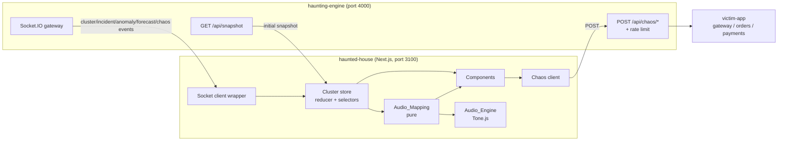
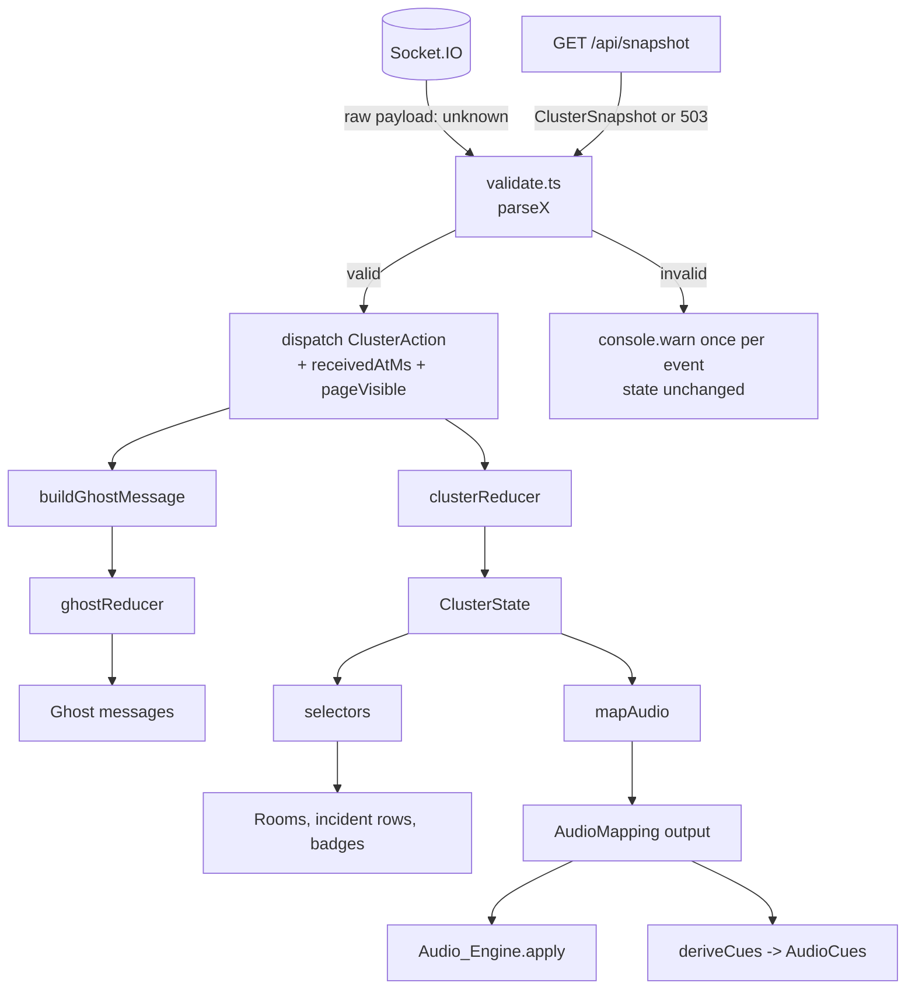
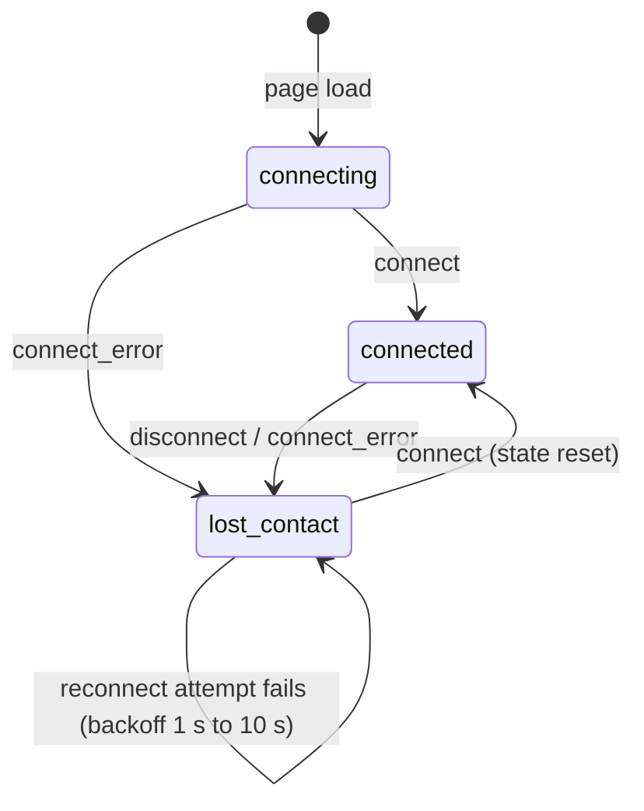
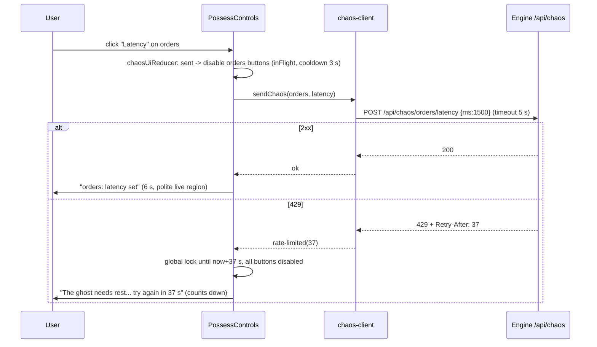
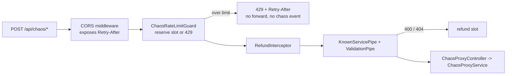

# Design Document: haunted-house

## Overview

`haunted-house/` is the Next.js (App Router) frontend of The Haunted Cluster. It connects to the haunting-engine over Socket.IO and turns the live `ClusterSnapshot`, incident, anomaly and forecast events into:

- a haunted-house scene with one Room per service, in service-chain order,
- a generative Tone.js soundscape driven by pure mapping functions,
- an incident panel, a ghost message area and "Possess it" chaos controls.

The same feature adds one change to the haunting-engine: a per-client rate limit on the chaos proxy, plus configurable CORS that exposes `Retry-After`.

### Design principles

- **Pure core, thin shell.** Everything that decides something (reducer, selectors, ghost messages, atmosphere, countdown rounding, audio mapping, chaos UI gating, Retry-After parsing, rate-limit decisions) is a pure function. Hooks, Socket.IO, Tone.js and `fetch` are thin shells around them. This matches the engine convention and makes the fast-check properties cheap.
- **One source of truth for sound and picture.** The Audio_Mapping output is computed once per state change. Both the Audio_Engine and the visual cues read that one object (Requirement 7.7).
- **Honest display.** `timeToLimitSeconds` is always shown with "~" and "est."; a root service is always "suspected root", with a restart caveat when the Engine can be wrong (roadmap.md, known open issues).
- **Shared types only from `@haunted-cluster/shared`.** The frontend never redeclares an event or payload type. Frontend-only types (view models, actions) are built from shared types by composition.
- **Chaos only through the proxy.** The frontend contains no URL for the victim-app `/chaos/*` endpoints.

### Research findings that shaped the design

| Question | Finding | Decision |
|---|---|---|
| Can `@nestjs/throttler` implement the chaos limit? | It uses fixed-window counters, increments in a guard (before `ValidationPipe` runs, so 400s would count) and has no refund. Requirement 9.3 needs `Retry-After` equal to the time until the *oldest counted request* leaves the window, which is sliding-window behaviour. | Write a small sliding-window limiter (about 60 lines of pure logic) with a guard that reserves a slot and an interceptor that refunds it for validation failures. No new engine dependency. |
| How does Express derive `req.ip` with `trust proxy`? | With `trust proxy = 1`, Express trusts only the direct peer as a proxy and takes the address that peer appended to `X-Forwarded-For` (the rightmost entry). Entries further left are client-controlled and are ignored. With `trust proxy` false, `X-Forwarded-For` is ignored completely. | `Client_Key = req.ip`. Set `trust proxy` to `1` only when `TRUST_PROXY=true`. This gives Requirements 9.9 and 9.10 with no custom header parsing. |
| Where does the `Retry-After` header reach the browser? | Cross-origin scripts can read only CORS-safelisted response headers unless the server sends `Access-Control-Expose-Headers`. `Retry-After` is not safelisted. | `enableCors({ origin, exposedHeaders: ['Retry-After'] })`. The same options object feeds the Socket.IO adapter so the two never drift. |
| When does `NEXT_PUBLIC_*` get its value? | Next.js inlines `process.env.NEXT_PUBLIC_*` references into the client bundle at build time. A later change to the runtime env does not change the bundle. | Matches Requirement 14.10. The Dockerfile takes it as a build `ARG`; the `.env.example` and compose file say a rebuild is needed to change it. |
| How to start Tone.js without creating an audio context early? | Tone creates its global context lazily, but importing the module can touch Web Audio in some versions, and browsers block audio until a user gesture. | The Audio_Engine imports Tone with a dynamic `import('tone')` inside the gesture handler. Before the gesture, Tone is never loaded, so zero contexts exist (Requirement 6.1). |
| Font loading with zero third-party requests | `next/font/google` self-hosts at build time but needs network during the build. `next/font/local` serves committed files. | Use `next/font/local` with committed `woff2` files (SIL OFL fonts). Builds work offline and the font origin is always the Frontend itself. |
| Jest for Next.js | `next/jest` configures SWC transforms, CSS stubs and `.mjs` handling for Jest 29. | Use `next/jest` with `jest-environment-jsdom` and Jest 29.7.0. Type checking runs separately with `tsc --noEmit`. |

Versions below are the intended pins; pins must be verified at install time with `npm view <pkg> version` (see Open Questions). Next is pinned to 14.2.35, the latest 14.2.x patch (checked on the npm registry), with React 18, because the app is public and later 14.2.x patches carry security fixes (Requirement 13.9). The other packages are: React and React DOM 18.3.1, `socket.io-client` 4.7.5 (same as the engine's dev dependency), `tone` 14.7.77, TypeScript 5.5.3, Jest 29.7.0, fast-check 3.20.0, `@types/node` 20.14.10, `@testing-library/react` 16.0.0.

## Architecture

### System context



### Folder layout of `haunted-house/`

Tests sit next to the file they test (`*.spec.ts`, `*.spec.tsx`, `*.prop.spec.ts` for fast-check).

```
haunted-house/
  app/
    layout.tsx                 fonts, token <style>, <html lang>
    page.tsx                   server component, renders <HauntedHouse/>
    globals.css                layout rules only; no colour literals
    api/health/route.ts        Frontend_Health_Route (GET /api/health)
    fonts/                     committed woff2 files (heading, body) + OFL licence text
  components/                  React function components only
    HauntedHouse.tsx           client root: wires store, audio, chaos
    HouseScene.tsx             roof + ground + fog SVG, floor grid
    RoomView.tsx               one Room: facade, metrics, badges, controls
    RoomFacade.tsx             per-room SVG (window, pattern per status)
    AnomalyBadge.tsx  ForecastBadge.tsx  ChaosMark.tsx
    PossessControls.tsx  ResetAllControl.tsx  ActionResult.tsx
    IncidentPanel.tsx  IncidentRow.tsx
    GhostArea.tsx
    SoundControls.tsx  AudioCues.tsx
    ConnectionBanner.tsx  BlindNotice.tsx
  audio/                       no React, no JSX, no hook imports
    mapping.ts                 mapAudio(), deriveCues(), nextSilenceUntil()
    audio-engine.ts            the ONLY file that imports 'tone'
    types.ts
  state/                       pure logic
    cluster-state.ts           ClusterState, clusterReducer, initialClusterState
    connection.ts              Connection_State machine
    selectors.ts               selectRooms(), selectIncidentRows(), selectCues()...
    validate.ts                payload guards (parseSnapshot, parseIncident, ...)
    ghost-messages.ts          buildGhostMessage(), ghostReducer
    forecast-format.ts         roundCountdown(), formatCountdown()
    atmosphere.ts              atmosphereFor(dread)
    chaos-ui.ts                chaosUiReducer, isDisabled(), countdown helpers
    format.ts                  formatMetric(), formatSignalValue(), dash for null
  lib/
    constants.ts               every tunable, with defaults from the requirements
    env.ts                     the ONLY reader of process.env.NEXT_PUBLIC_ENGINE_URL
    engine-url.mjs (+ .d.mts)  parseEngineUrl(); shared with next.config.mjs
    socket-client.ts           createEngineConnection(), EngineSocketLike
    engine-api.ts              fetchSnapshot()
    chaos-client.ts            sendChaos(), sendResetAll(), parseRetryAfter()
  hooks/                       thin React shells over the pure logic
    useClusterStore.ts  useAudio.ts  useChaosControls.ts
    useDeadlineClock.ts  useReducedMotion.ts  usePageVisible.ts
  design/
    tokens.ts                  Design_Tokens, light + dark, defined once
    tokens-css.ts              tokensToCss() -> :root + prefers-color-scheme rules
    contrast.ts                contrastRatio() used by tests
  scripts/
    check-shared-dist.mjs      Requirement 13.8
    check-structure.mjs        Requirements 13.2, 13.4 to 13.7, 12.6
    clean.mjs                  removes .next so a failed check leaves no output
    probe-snapshot.mjs         full-stack boot probe (Socket.IO)
  next.config.mjs              calls parseEngineUrl() (build and start)
  jest.config.mjs  tsconfig.json  package.json  Dockerfile
  .env.example
```

### Build order and structural checks

`shared/` is built first, then the structural checks, then Next:

```
"build:shared": "tsc -p ../shared/tsconfig.json",
"prebuild":     "node scripts/clean.mjs && npm run build:shared && node scripts/check-shared-dist.mjs && node scripts/check-structure.mjs",
"build":        "next build",
"start":        "next start -p 3100 -H 0.0.0.0",
"pretest":      "npm run build:shared && node scripts/check-shared-dist.mjs",
"test":         "jest --runInBand",
"typecheck":    "tsc --noEmit"
```

- If `build:shared` fails, npm stops with a non-zero exit code before `next build` starts (13.3).
- `check-shared-dist.mjs` verifies that `../shared/dist/index.d.ts`, `events.d.ts`, `service-health.d.ts`, `incident.d.ts`, `intelligence.d.ts` and `chaos.d.ts` exist, and otherwise exits 1 naming the missing file (13.8).
- `check-structure.mjs` scans `haunted-house/` source and test files (excluding `node_modules`, `.next`) and exits 1 on any of:
  - an import path matching `shared/src` (13.2);
  - an `any` type (`: any`, `as any`, `<any>`, `any[]`) without a `//` comment on the same or previous line (13.4);
  - a `react`, `react-dom` or JSX/TSX file under `audio/` (13.5);
  - an `import ... from 'tone'` or `import('tone')` outside `audio/audio-engine.ts` (6.16);
  - `extends React.Component`, `extends Component`, `extends PureComponent` (13.6);
  - a colour literal (`#rgb[a]`, `#rrggbb[aa]`, `rgb(`, `rgba(`, `hsl(`) outside `design/tokens.ts` and `design/tokens.spec.ts` (12.6);
  - the words `openai`, `anthropic`, `api_key`, `apikey`, or a `Bearer ` literal in non-test source (13.7);
  - a URL or path containing `/chaos/` that is not preceded by `/api` (8.4).
- The same check functions are exported and run by `scripts/check-structure.spec.mjs`-style Jest tests against fixture strings, so the checks themselves are tested.
- `tsconfig.json` sets `"strict": true` and `paths: { "@haunted-cluster/shared": ["../shared/dist/index"] }`, mirroring the engine. Shared types are imported with `import type` only.

### Build-time and start-time environment validation

`next.config.mjs` imports `parseEngineUrl` from `lib/engine-url.mjs` and calls it on `process.env.NEXT_PUBLIC_ENGINE_URL`. `next.config.mjs` is loaded by both `next build` and `next start`, so a missing or invalid value stops both with an error naming `NEXT_PUBLIC_ENGINE_URL` and nothing is served (1.2, 14.9). The runtime image therefore runs `next start` rather than Next's `standalone` output, because `standalone` embeds a pre-evaluated config and would skip the start-time check.

`parseEngineUrl(raw)` accepts only an absolute `http:` or `https:` URL, strips trailing slashes, and throws an `Error` whose message contains `NEXT_PUBLIC_ENGINE_URL` otherwise. `lib/env.ts` reads `process.env.NEXT_PUBLIC_ENGINE_URL` literally (so Next can inline it), passes it through `parseEngineUrl`, and exports `ENGINE_URL`. No other module reads the variable or contains a host fallback (14.7).

### Docker and compose

Build context is the repository root, like the engine (`shared/` is needed).

```dockerfile
# Build context is the repo root (needs shared/):
#   docker build -f haunted-house/Dockerfile --build-arg NEXT_PUBLIC_ENGINE_URL=http://localhost:4000 .
FROM node:20-alpine AS builder
WORKDIR /app/haunted-house
COPY haunted-house/package*.json ./
RUN npm ci
COPY shared/ /app/shared/
COPY haunted-house/ ./
# Fixed at build time: Next inlines NEXT_PUBLIC_* into the browser bundle.
ARG NEXT_PUBLIC_ENGINE_URL
ENV NEXT_PUBLIC_ENGINE_URL=$NEXT_PUBLIC_ENGINE_URL
RUN npm run build && npm prune --omit=dev   # prebuild: shared first, then checks

FROM node:20-alpine
WORKDIR /app/haunted-house
ENV NODE_ENV=production
ARG NEXT_PUBLIC_ENGINE_URL
ENV NEXT_PUBLIC_ENGINE_URL=$NEXT_PUBLIC_ENGINE_URL
COPY --from=builder /app/haunted-house/.next ./.next
COPY --from=builder /app/haunted-house/node_modules ./node_modules
COPY --from=builder /app/haunted-house/package.json /app/haunted-house/next.config.mjs ./
COPY --from=builder /app/haunted-house/lib/engine-url.mjs ./lib/engine-url.mjs
EXPOSE 3100
CMD ["npm", "run", "start"]
```

With no `--build-arg`, the variable is empty and the `RUN npm run build` step fails at `parseEngineUrl` (1.2). The root `.dockerignore` currently lists `haunted-house`; that line is removed and `**/.next` is added, otherwise the frontend context would be empty. The engine image is unaffected because its Dockerfile copies only named folders.

Compose service (comments are required by 14.13):

```yaml
  haunted-house:
    build:
      context: .
      dockerfile: haunted-house/Dockerfile
      args:
        # Fixed at build time (inlined into the browser bundle). Changing it means
        # rebuilding this image: docker compose build haunted-house
        NEXT_PUBLIC_ENGINE_URL: ${NEXT_PUBLIC_ENGINE_URL:-http://localhost:4000}
    ports:
      - "3100:3100"
    restart: unless-stopped
    depends_on:
      haunting-engine:
        condition: service_healthy
    healthcheck:
      test: ["CMD", "wget", "-qO-", "http://127.0.0.1:3100/api/health"]
      interval: 10s
      timeout: 5s
      retries: 5
      start_period: 20s
```

`depends_on` uses `service_healthy` (the engine has a healthcheck) so the house starts after the engine. `127.0.0.1` avoids Alpine resolving `localhost` to `::1` while Next listens on `0.0.0.0`. `start_period` does not change the 10 s / 5 s / 5 retries values the requirement fixes.

The engine service gains `CORS_ORIGIN`, `CHAOS_RATE_LIMIT_MAX`, `CHAOS_RATE_LIMIT_WINDOW_SECONDS` and `TRUST_PROXY` (see Engine changes).

### Frontend data flow



### Connection state machine



`connectionReducer(state, event)` is a pure total function over `'page-load' | 'connect' | 'connect_error' | 'disconnect'`. It never returns `connecting` after the first `connect_error`; once contact is lost the state stays `lost_contact` until `connect`.

### Chaos request and rate-limit sequence



### Engine request pipeline with the rate limit



## Components and Interfaces

### Constants (`lib/constants.ts`)

One module, with the defaults the requirements state (14.7):

```ts
export const RECENT_INCIDENTS_LIMIT = 10;
export const GHOST_MESSAGE_LIMIT = 50;
export const CHAOS_COOLDOWN_MS = 3000;
export const CHAOS_REQUEST_TIMEOUT_MS = 5000;
export const RESULT_VISIBLE_MS = 6000;
export const SILENCE_MS = 1500;
export const HEARTBEAT_MIN_BPM = 40;
export const HEARTBEAT_MAX_BPM = 180;
// Additional constants introduced by this design
export const MAX_ROOMS = 8;                    // Requirement 11.10
export const RATE_LIMIT_DEFAULT_WAIT_S = 10;   // Requirement 10.2
export const RETRY_AFTER_MAX_S = 3600;         // Requirement 10.2
export const CHAOS_MARK_VISIBLE_MS = 8000;     // how long a chaos:triggered mark stays on a Room
export const AUDIO_RAMP_MS = 150;              // >= 100 (Requirement 6.17)
export const AMBIENT_BASE = 0.08;              // quiet hum at Dread 0
export const BLIND_AMBIENT = 0.3;              // fixed, in (0, 1) (Requirement 6.13)
export const LOST_CONTACT_TONE_LEVEL = 0.2;    // in (0, 1] (Requirement 6.12)
export const FORECAST_HEARTBEAT_HORIZON_S = 90;// time-to-limit at which the forecast drive is 0
export const FORECAST_HEARTBEAT_FLOOR = 0.05;  // minimum drive while a forecast is active
export const SOCKET_BACKOFF_MIN_MS = 1000;     // Requirement 1.5
export const SOCKET_BACKOFF_MAX_MS = 10000;
export const SOCKET_CONNECT_TIMEOUT_MS = 5000;
```

### Payload validation (`state/validate.ts`)

Socket payloads arrive as `unknown` at runtime. Each `parseX(raw: unknown): T | null` checks every field the shared type requires (types of `timestamp`, `metricsAvailable`, `dread` finite, `services[].service/status/signals/badness`, `anomalies[]`, `forecasts[]`, incident `id/status/rootService/kinds/affected/openedAt/relatedChaos`, `ChaosEvent`, anomaly cleared and forecast cleared payloads). It returns `null` on a missing or wrongly typed field.

`status` is validated only as a string, not against the five values, because Requirement 2.12 wants a bad status to degrade one Room to `unknown` instead of rejecting the whole snapshot. The selector normalizes it (`normalizeStatus`).

`handleEvent(name, raw, dispatch)` in the store hook calls the parser; on `null` it logs one `console.warn` naming the event (rate-limited to one per event name per second to avoid log floods) and dispatches nothing (1.11).

### Cluster state (`state/cluster-state.ts`)

```ts
import type {
  AnomalyReading, ChaosEvent, ClusterSnapshot, Incident, MemoryForecast, ServiceName, MonitoredSignal,
} from '@haunted-cluster/shared';

export type ConnectionState = 'connecting' | 'connected' | 'lost_contact';

export interface ClusterState {
  connection: ConnectionState;
  snapshot: ClusterSnapshot | null;
  openIncidents: Incident[];
  recentIncidents: Incident[];          // newest first, <= RECENT_INCIDENTS_LIMIT
  anomalies: AnomalyReading[];          // confirmed, unique per (service, signal)
  forecasts: MemoryForecast[];          // unique per service
  chaosMarks: Record<ServiceName, { event: ChaosEvent; receivedAtMs: number }>;
  silenceUntilMs: number | null;        // sudden-silence deadline, see Audio
  lostContactAtMs: number | null;       // freezes incident durations
}

export type ClusterAction =
  | { type: 'connection'; event: 'connect' | 'connect_error' | 'disconnect'; atMs: number }
  | { type: 'snapshot'; snapshot: ClusterSnapshot; atMs: number; pageVisible: boolean }
  | { type: 'incident:list'; open: Incident[] }
  | { type: 'incident:opened' | 'incident:updated' | 'incident:resolved'; incident: Incident }
  | { type: 'chaos:triggered'; event: ChaosEvent; atMs: number }
  | { type: 'anomaly:detected'; reading: AnomalyReading }
  | { type: 'anomaly:cleared'; service: ServiceName; signal: MonitoredSignal }
  | { type: 'forecast:warning'; forecast: MemoryForecast }
  | { type: 'forecast:cleared'; service: ServiceName };

export function clusterReducer(state: ClusterState, action: ClusterAction): ClusterState;
```

The reducer is pure: time and page visibility come in on the action, never from `Date.now()` or `document`. It never mutates its input.

Rules:

- **`connection: connect`**: set `connection = 'connected'`, `lostContactAtMs = null`, and discard the Stale_Snapshot and everything derived from it: `snapshot`, `anomalies`, `forecasts`, `chaosMarks`, `openIncidents`, `silenceUntilMs` are reset. `recentIncidents` is kept, because resolved incidents cannot be refetched over Socket.IO (Requirements 1.6 and 4.16; see Open Questions, item 2). Open incidents are replaced by the `incident:list` that follows. The Engine then sends `cluster:snapshot` and `incident:list` immediately (`EventsGateway.handleConnection`).
- **`connection: connect_error | disconnect`**: `connection = 'lost_contact'`, `lostContactAtMs = atMs` (first time only), `anomalies = []`, `forecasts = []` (3.11). `snapshot` is kept only so the stale values can be dropped by the connect reset; selectors never display it while `lost_contact` (1.7). Incidents are kept (4.15).
- **`snapshot`**: ignored if `state.snapshot` exists and `Date.parse(incoming.timestamp) < Date.parse(state.snapshot.timestamp)` (a late REST response must not overwrite a newer socket snapshot). Otherwise `snapshot = incoming`, `anomalies = incoming.anomalies`, and `forecasts = incoming.forecasts`. Applying the same snapshot twice yields an equal state (idempotence). If `pageVisible` and the previous snapshot has a service whose status was not `down` and the incoming one has it `down`, then `silenceUntilMs = nextSilenceUntil(atMs)`, one restart per snapshot however many services went down (6.11, 6.19). A first snapshot (no previous) never triggers a silence.
- **`incident:list`**: `openIncidents = open` (4.1).
- **`incident:opened | incident:updated`**: upsert by `id` into `openIncidents` (4.2).
- **`incident:resolved`**: remove from `openIncidents`, then `recentIncidents = [incident, ...recent without that id].slice(0, RECENT_INCIDENTS_LIMIT)` (4.3, 4.4).
- **`anomaly:detected`**: upsert by `(service, signal)`; **`anomaly:cleared`**: remove that key only (3.2, 3.3).
- **`forecast:warning`**: upsert by `service`; **`forecast:cleared`**: remove by `service` (3.9; the `reason` goes to the Ghost_Area, not to this state).
- **`chaos:triggered`**: `chaosMarks[service] = { event, receivedAtMs }`.

The Ghost_Area is a separate pure reducer (`ghostReducer`) outside `ClusterState`, so ghost history survives a reconnect, like Recent_Incidents.

### Selectors (`state/selectors.ts`)

```ts
export type RoomStatus = 'healthy' | 'degraded' | 'critical' | 'down' | 'unknown';
export function normalizeStatus(raw: string): RoomStatus;      // anything else -> 'unknown' (2.12)

export interface RoomView {
  service: ServiceName;
  status: RoomStatus;                 // effective status
  score: number | null;
  metrics: { latency: string; errorRate: string; rss: string; requestRate: string; score: string };
  anomalies: AnomalyView[];           // label: "<signal> <value> (<method>)" + a11y text
  countdown: CountdownView | null;
  highlighted: boolean;               // suspected root of a displayed incident
  chaosMark: string | null;           // "<action>" while within CHAOS_MARK_VISIBLE_MS
  stale: boolean;
}
export function selectRooms(state: ClusterState, nowMs: number): RoomView[];
```

`selectRooms`:

- returns `[]` when `snapshot` is null (the "waiting for the first poll" message is shown by the component) (2.9);
- takes `snapshot.services.slice(0, MAX_ROOMS)` in order and never hardcodes names (2.1, 2.2, 11.10);
- forces every Room to `unknown` when `connection === 'lost_contact'` (1.7) or `!snapshot.metricsAvailable` (2.8);
- otherwise `status = normalizeStatus(health.status)`;
- formats metrics with `format.ts`: `formatMetric(null | undefined) === '—'`; error ratio as a percentage; RSS in MB; latency in ms; request rate per second (2.7).

Other selectors: `selectIncidentRows` (order, wording, caveat, durations, stale marking), `selectHighlightedServices`, `selectBlind`, `selectAtmosphere`, `selectAudioInput`.

### Format helpers and countdown (`state/forecast-format.ts`)

```ts
export function roundCountdown(timeToLimitSeconds: number): number;
// Math.max(5, Math.round(t / 5) * 5)

export type CountdownView = { text: string; ariaLabel: string };
export function selectCountdown(f: MemoryForecast): CountdownView | null;
// warning && ttl !== null && ttl > 0  -> "<service> dies in ~<N> s (est.)"
// warning && ttl === 0                -> "<service> is about to die (est.)"
// otherwise                           -> null
```

Every countdown text contains "~" (or, for the `0` case, the words "about to die") plus "est." (3.7). Because Requirement 3.7 says every countdown contains "~" and "est.", the `0` case is formatted `"<service> is about to die (~0 s, est.)"` to satisfy both 3.7 and 3.8. The `ariaLabel` states the service and the estimated seconds (3.12).

### Atmosphere (`state/atmosphere.ts`)

```ts
export interface Atmosphere { darkness: number; flicker: number; fog: number }  // each in [0, 1]
export function atmosphereFor(dread: number): Atmosphere;
```

With `d = clamp01(finite(dread))` (non-finite becomes 0):

- `darkness = 0.15 + 0.6 * d`
- `flicker = clamp01((d - 0.3) / 0.7)`
- `fog = 0.1 + 0.7 * d`

All three are non-decreasing in `d` (2.10). They are applied as CSS custom properties `--darkness`, `--flicker`, `--fog` on the scene root. Under reduced motion, flicker is rendered as a static opacity step, never an animation (2.11).

### Ghost messages (`state/ghost-messages.ts`)

```ts
export type GhostSourceEvent =
  | { type: 'incident:opened'; incident: Incident }
  | { type: 'incident:resolved'; incident: Incident }
  | { type: 'forecast:warning'; forecast: MemoryForecast }
  | { type: 'forecast:cleared'; payload: ForecastClearedPayload }
  | { type: 'anomaly:detected'; reading: AnomalyReading }
  | { type: 'chaos:triggered'; event: ChaosEvent };

export interface GhostMessage {
  id: string;                    // `${type}:${stable key}:${at}`: deterministic
  at: string;                    // the timestamp argument, ISO 8601
  severity: 'info' | 'warning' | 'alarm';
  source: GhostSourceEvent['type'] | 'narrator';   // 'narrator' reserved for the later spec (5.13)
  text: string;
}

export function buildGhostMessage(event: GhostSourceEvent, at: string): GhostMessage | null;
export function ghostReducer(messages: GhostMessage[], message: GhostMessage): GhostMessage[];
```

`buildGhostMessage` is pure and deterministic. It returns `null` when a field it needs is missing or not finite (5.15). `ghostReducer` prepends, drops an existing message with the same `id`, and keeps at most `GHOST_MESSAGE_LIMIT` (5.1, 5.2). Wording per event:

| Event | Text pattern (all numbers come from the payload) |
|---|---|
| `incident:opened` | `I suspect <root> may be haunted: <kinds joined> trouble reaching <affected services joined>.` plus `I have seen this pattern before.` when `recurrence` or `similar` is non-null, plus `It looks <N>% like an earlier incident.` when `similar` is non-null (`N = round(similarity * 100)`) |
| `incident:resolved` | `The haunting at <root> (suspected) faded after <S> s.` with `S = round(durationMs / 1000)` |
| `forecast:warning` | `<service> may run out of memory in ~<N> s (estimate).` with `N = roundCountdown(ttl)`; when `ttl` is null the message is not produced |
| `forecast:cleared` | `<service>'s memory scare ended: <reason>.` |
| `anomaly:detected` | `<service> feels strange: <signal> is <value>.` using `formatSignalValue` |
| `chaos:triggered` | `Someone possessed <service>: <action>.` |

Every incident-opened message contains one of "suspect", "may" (5.3). Severity: opened = `alarm`, forecast warning = `warning`, resolved/cleared = `info`.

### Chaos client (`lib/chaos-client.ts`)

```ts
import type { ChaosAction, ServiceName } from '@haunted-cluster/shared';

export type ChaosButton = 'latency' | 'errors' | 'memory-leak' | 'crash' | 'reset';

export const CHAOS_PRESETS = {
  latency:       { path: 'latency',     action: 'latency'     as ChaosAction, body: { ms: 1500 } },
  errors:        { path: 'error-rate',  action: 'error-rate'  as ChaosAction, body: { percentage: 50 } },
  'memory-leak': { path: 'memory-leak', action: 'memory-leak' as ChaosAction, body: { enabled: true } },
  crash:         { path: 'crash',       action: 'crash'       as ChaosAction },
  reset:         { path: 'reset',       action: 'reset'       as ChaosAction },
} as const;

export type ChaosOutcome =
  | { kind: 'ok'; service: ServiceName; action: ChaosAction }
  | { kind: 'rejected'; message: string }                            // 4xx except 429
  | { kind: 'rate-limited'; waitSeconds: number; waitKnown: boolean } // 429
  | { kind: 'service-unreachable' }                                  // 502, 504
  | { kind: 'engine-error'; status: number }                         // any other non-2xx
  | { kind: 'engine-unreachable' };                                  // network error or timeout

export interface ChaosDeps { fetchImpl: typeof fetch; engineUrl: string; timeoutMs: number }
export function sendChaos(deps: ChaosDeps, service: ServiceName, button: ChaosButton): Promise<ChaosOutcome>;

export type ResetAllOutcome =
  | { kind: 'ok'; results: { service: ServiceName; ok: boolean }[] }
  | { kind: 'rate-limited'; waitSeconds: number; waitKnown: boolean }
  | { kind: 'failed' };
export function sendResetAll(deps: ChaosDeps): Promise<ResetAllOutcome>;

export function parseRetryAfter(header: string | null): number | null;
export function classifyStatus(status: number, ...): ChaosOutcome;     // pure status mapping
```

Behaviour:

- URL is always `${engineUrl}/api/chaos/${encodeURIComponent(service)}/${path}`; reset-all is `${engineUrl}/api/chaos/reset-all`. Method is `POST`. JSON bodies carry `content-type: application/json`; crash, reset and reset-all send no body and no content-type header (8.2, 8.3, 8.4).
- A timer aborts the request through `AbortController` after `CHAOS_REQUEST_TIMEOUT_MS`; an abort or any thrown error becomes `engine-unreachable` (8.10, 8.11).
- `parseRetryAfter`: the header must match `/^\d+$/` and be between 1 and 3600 inclusive, else `null`. A decimal, negative, empty, non-numeric or out-of-range value is `null` (10.1, 10.2). On `null`, the outcome is `{ waitSeconds: RATE_LIMIT_DEFAULT_WAIT_S, waitKnown: false }`.
- For 4xx other than 429 the message is `body.message`, joined with `", "` when it is an array, with a fallback of `"request rejected (<status>)"` if the body has no message (8.7).
- `reset-all` returns the Engine's `{ results: ResetResult[] }` on 200; the UI shows, for each service in the latest snapshot, success or failure, and treats a missing entry as failed. A non-2xx or network failure is `failed` and names no service as reset (8.14, 8.15).
- The client never retries (10.7).

### Chaos UI state (`state/chaos-ui.ts`)

```ts
export interface ServiceChaosUi {
  inFlight: boolean;
  cooldownUntilMs: number;
  result: { outcome: ChaosOutcome; expiresAtMs: number } | null;
}
export interface ChaosUiState {
  services: Record<ServiceName, ServiceChaosUi>;
  resetAll: { inFlight: boolean; cooldownUntilMs: number; result: ... | null };
  rateLimit: { untilMs: number; waitKnown: boolean } | null;   // global lock
}
export type ChaosUiAction =
  | { type: 'sent'; service: ServiceName; atMs: number }
  | { type: 'completed'; service: ServiceName; outcome: ChaosOutcome; atMs: number }
  | { type: 'reset-all-sent'; atMs: number }
  | { type: 'reset-all-completed'; outcome: ResetAllOutcome; atMs: number };

export function chaosUiReducer(state: ChaosUiState, action: ChaosUiAction): ChaosUiState;
export function isServiceDisabled(ui: ChaosUiState, service: ServiceName, conn: ConnectionState, nowMs: number): boolean;
export function isResetAllDisabled(ui: ChaosUiState, conn: ConnectionState, nowMs: number): boolean;
export function rateLimitRemainingSeconds(ui: ChaosUiState, nowMs: number): number | null;
```

- `sent`: `inFlight = true`, `cooldownUntilMs = atMs + CHAOS_COOLDOWN_MS`, previous result cleared.
- `completed`: `inFlight = false`; `result = { outcome, expiresAtMs: atMs + RESULT_VISIBLE_MS }`. On a `rate-limited` outcome, `rateLimit = { untilMs: atMs + waitSeconds * 1000, waitKnown }`, replacing any existing lock with the newest value (10.6).
- A button is disabled when `conn !== 'connected'` (1.8, 8.16), or `inFlight`, or `nowMs < cooldownUntilMs` (the later of cooldown and completion, 8.5), or a rate-limit lock is active (10.3). Reset-all follows the same rules with its own state.
- `rateLimitRemainingSeconds` returns `ceil((untilMs - nowMs) / 1000)` while the lock is active and the wait is known, `null` otherwise (10.4).
- A result is visible while `nowMs < expiresAtMs` (8.12).

`useDeadlineClock(deadlines)` is the only timer hook for this: it sets one `setTimeout` for the nearest future deadline (cooldown end, result expiry, lock end, silence end) and bumps a `now` state when it fires, plus a 1 s interval only while a known-wait lock is counting down or an open incident is visible. This is how buttons re-enable within 200 ms of the deadline (10.5) without polling every frame.

### Socket client (`lib/socket-client.ts`)

```ts
export interface EngineSocketLike {
  on(event: string, handler: (...args: unknown[]) => void): void;
  off(event: string, handler: (...args: unknown[]) => void): void;
  disconnect(): void;
}
export type SocketFactory = (url: string) => EngineSocketLike;
export function createEngineConnection(url: string, factory: SocketFactory, sink: ConnectionSink): () => void;
```

The default factory builds `io(url, { transports: ['websocket', 'polling'], reconnection: true, reconnectionAttempts: Infinity, reconnectionDelay: 1000, reconnectionDelayMax: 10000, randomizationFactor: 0, timeout: 5000 })`, typed as `Socket<ServerToClientEvents, ClientToServerEvents>`. `randomizationFactor: 0` is set so the first retry waits exactly 1 s as Requirement 1.5 states (socket.io's default jitter could shorten it). `timeout: 5000` makes an unreachable host fail within 5 s so the state moves to `lost_contact` instead of staying in `connecting`.

`createEngineConnection` subscribes to the ten events from `ServerToClientEvents`, passes each payload to the validators, and returns an unsubscribe/disconnect function used on unmount. Tests pass a fake `EngineSocketLike` built on an event emitter (15.7).

`lib/engine-api.ts` provides `fetchSnapshot(fetchImpl, engineUrl): Promise<ClusterSnapshot | null>`: one `GET /api/snapshot` at page load; 503 returns `null` silently (1.10); other failures log one warning and return `null`.

### React components

All are function components; none touch Tone.js. Components get data as props from `HauntedHouse`.

| Component | Responsibility | Requirements |
|---|---|---|
| `HauntedHouse` | Client root. Props: `engineUrl`, optional injected `socketFactory`, `fetchImpl`, `clock`. Builds the store, ghost list, chaos UI, audio hook; renders everything. | 1, 15.7 |
| `HouseScene` | SVG roof, chimney, ground and fog; a grid of `RoomView`s in service-chain order. Sets `--darkness/--flicker/--fog`. | 2, 12, 11 |
| `RoomView` | One Room: `RoomFacade`, name, status text, metrics, badges, cue marks, `PossessControls`. | 2, 3, 7, 8 |
| `RoomFacade` | Per-room inline SVG: window and frame with a distinct pattern per status. | 2.4, 12.9 |
| `AnomalyBadge`, `ForecastBadge`, `ChaosMark` | Text-bearing badges with `aria-label`s. | 3, 8.13 |
| `PossessControls` | Five labelled buttons, in-progress indicator, result region. | 8 |
| `ResetAllControl` | The "Reset all" button and per-service results. | 8.14 to 8.16 |
| `IncidentPanel`, `IncidentRow` | Open then recent incidents, caveats, durations. | 4 |
| `GhostArea` | `aria-live="polite"` list of messages, newest first. | 5 |
| `SoundControls` | "Enable sound", Mute, status text ("sound off", "muted", "sound unavailable"). | 6.1 to 6.5, 6.18 |
| `AudioCues` | Renders the cues from `deriveCues(output)`. | 7 |
| `ConnectionBanner`, `BlindNotice` | "lost contact" and "the ghost cannot see". | 1.7, 2.8 |

Layout, ARIA and keyboard rules: every control is a native `<button>` with visible text; focus uses the `--focus` token via `:focus-visible`; the status of a Room is always text next to the SVG; SVGs that carry meaning have `role="img"` and `aria-label`, decorative ones `aria-hidden`.

### Audio_Mapping (`audio/mapping.ts`)

All pure; no Tone.js, no React, no `Date.now()`.

```ts
export interface AudioInput {
  connection: ConnectionState;
  snapshot: ClusterSnapshot | null;
  forecasts: MemoryForecast[];        // the active forecasts from ClusterState
  silenceUntilMs: number | null;
  nowMs: number;
}

export interface AudioMapping {
  ambient: number;                           // [0, 1]
  whispers: number;                          // [0, 1]
  screams: number;                           // [0, 1]
  heartbeat: { level: number; bpm: number }; // level [0, 1]; bpm 0 when level 0, else [40, 180]
  lostContactTone: number;                   // [0, 1]
  silence: boolean;                          // true while nowMs < silenceUntilMs
  whisperRoom: ServiceName | null;           // where the whispers cue shows
  screamRoom: ServiceName | null;
  state: 'live' | 'blind' | 'lost-contact' | 'unavailable';
}

export function mapAudio(input: AudioInput): AudioMapping;
export function nextSilenceUntil(nowMs: number, silenceMs = SILENCE_MS): number; // restart, never extend
export function deriveCues(output: AudioMapping): AudioCues;
```

Mapping rules, applied in this order:

1. **No snapshot and not lost contact**: `state = 'unavailable'`, all levels 0 (7.8).
2. **`connection === 'lost_contact'`**: `state = 'lost-contact'`, `lostContactTone = LOST_CONTACT_TONE_LEVEL`, every other level 0 (6.12, 1.8).
3. **`!snapshot.metricsAvailable`**: `state = 'blind'`, `ambient = BLIND_AMBIENT` (independent of Dread), whispers, screams and heartbeat 0 (6.13).
4. **Live**:
   - `ambient = AMBIENT_BASE + (1 - AMBIENT_BASE) * clamp01(dread)`: non-decreasing, within [0, 1] (6.6).
   - `whispers = max latency badness` over services whose status is neither `unknown` nor `down`; 0 if none (6.7). `whisperRoom` is the first such service in chain order that reaches the maximum.
   - `screams = max errors badness` over all services; 0 for an empty list (6.8). `screamRoom` likewise.
   - Heartbeat: see "Heartbeat trigger" below.
5. **Silence**: if `silenceUntilMs !== null && nowMs < silenceUntilMs`, `silence = true` and `ambient`, `whispers`, `screams`, `heartbeat.level`, `lostContactTone` are all 0 (the cue rooms and `state` are unchanged). When `nowMs >= silenceUntilMs` the layers resume at their mapped levels (6.11).
6. **Sanitize last**: every number goes through `finite01` (non-finite becomes 0, clamp to [0, 1]); bpm is clamped to [40, 180] when level > 0 (6.10, 6.14).

#### Heartbeat trigger (Requirement 6, criterion 9)

Requirement 6.9 says the heartbeat plays WHILE any service has an active Forecast_Countdown or a memory `badness` above 0, and its level is 0 otherwise. The mapping implements exactly that. The heartbeat is active while **either** (a) some service has an active forecast (`warning` true, `timeToLimitSeconds` non-null), **or** (b) the highest `badness.memory` among services whose status is neither `unknown` nor `down` is above 0. Level and rate come from one drive value:

```
memoryDrive   = max memory badness (eligible services)                 // 0..1
forecastDrive = for each active forecast: t = ttl (0 if ttl <= 0)
                  max(FORECAST_HEARTBEAT_FLOOR, 1 - t / FORECAST_HEARTBEAT_HORIZON_S)
                max over forecasts, 0 if none                         // shorter ttl -> larger
drive         = max(memoryDrive, forecastDrive)
level         = drive                         (0 when neither trigger is active)
bpm           = level > 0 ? HEARTBEAT_MIN_BPM + (HEARTBEAT_MAX_BPM - HEARTBEAT_MIN_BPM) * level : 0
```

Higher memory badness or a shorter time to limit never gives a slower heartbeat. Using the Engine's own badness (which rises only above `MEMORY_OK_MB`) means ordinary RSS noise on a healthy service does not start a heartbeat. The mapping needs no previous snapshot, so the mapping input keeps no history.

#### Cues (`deriveCues`)

```ts
export interface AudioCues {
  ambient: { visible: boolean; intensity: number };          // visible iff ambient > 0
  whispers: { room: ServiceName | null };                    // non-null iff whispers > 0
  screams: { room: ServiceName | null };                     // non-null iff screams > 0
  heartbeat: { visible: boolean; bpm: number };              // pulse rate = bpm
  silence: boolean;
  lostContact: boolean;                                       // the lost-contact tone's cue
  dataUnavailable: boolean;                                   // state 'unavailable' or 'lost-contact'
}
```

`deriveCues` reads only an `AudioMapping`; `HauntedHouse` calls `mapAudio` once in a `useMemo`, then passes the same object to `useAudio` (engine) and to `deriveCues` (picture), so both derive from identical values (7.7). When `dataUnavailable`, `AudioCues` hides every cue except one "sound data unavailable" indicator; in `lost-contact` that indicator is also the visible counterpart of the constant tone (1.8, 7.8). The cues render whether or not sound is enabled or muted, because mute is applied in the Audio_Engine, not in the mapping (7.6). The ambient cue intensity is the ambient level quantized to steps of 0.05 so that a change of at least 0.05 always gives a visibly different state (7.1). Under reduced motion the heartbeat cue is a static indicator with the bpm as text (7.9).

`useDeadlineClock` schedules a re-render at `silenceUntilMs`, so the silence cue and the layers resume within 250 ms of the deadline (7.5).

### Audio_Engine (`audio/audio-engine.ts`)

The only file that imports `tone`.

```ts
export interface AudioEngine {
  start(): Promise<void>;                 // must run from a user gesture; creates the context
  apply(output: AudioMapping): void;      // ramps layer gains and heartbeat tempo
  setMuted(muted: boolean): void;
  dispose(): void;
}
export function createAudioEngine(importTone?: () => Promise<typeof import('tone')>): AudioEngine;
```

- **Start.** `start()` runs `const Tone = await importTone(); await Tone.start();` then builds the graph. Nothing is imported or created before it is called (6.1). It must be called from the click handler of "enable sound" (6.2). If it throws, `SoundControls` shows "sound unavailable" and keeps the button for retry; visuals are unaffected (6.18).
- **Layers**, each ending in its own `Tone.Gain` into a master `Tone.Gain` then `Tone.Limiter(-3)` then the destination:
  - `ambient`: brown noise through a low-pass filter whose cutoff rises with the level, plus a detuned pad (`FatOscillator`);
  - `whispers`: pink noise through a band-pass filter (3 to 6 kHz) with a slow tremolo;
  - `screams`: two detuned sawtooth voices with a pitch glide and distortion;
  - `heartbeat`: a `MembraneSynth` playing a two-thump "lub-dub" pattern on a `Tone.Loop`; `Transport.bpm` ramps to `heartbeat.bpm`, and the layer gain follows `heartbeat.level`;
  - `lostContactTone`: a low sine at 55 Hz.
  - Gain ceilings keep the mix in a safe range (ambient 0.35, whispers 0.25, screams 0.3, heartbeat 0.5, lost-contact 0.12).
- **Ramps.** Every gain change is `gain.rampTo(target, Math.max(AUDIO_RAMP_MS, 100) / 1000)`. No `gain.value = x` step changes are used (6.17). Silence uses the same ramp to 0 and back.
- **Mute.** `setMuted` ramps the master gain to 0 or back to 1 over 150 ms, within the 300 ms the requirement allows (6.4). Mute is separate from the mapping so the cues keep working (7.6). The mute button is a native `<button aria-pressed>` that responds to Enter and Space.
- **Hidden page.** `usePageVisible` reports `document.visibilityState`. While hidden, the engine still applies each new mapping so levels stay consistent with the latest state. `silence` is ignored by the engine while the page is hidden, and the reducer does not start a silence for a snapshot received while hidden (`pageVisible: false`), so no sound event queued while hidden plays on return. On `visibilitychange` to visible the hook re-applies the current mapping once (6.19).

### Visual identity

#### Haunted_Scene structure (12.1, 12.2)

The scene is one component, `HouseScene`. Its shared SVG elements sit behind and above a floor grid of Room parts; each Room contributes its own SVG facade. Room text and buttons are real HTML placed on the wall for accessibility, so the "scene" is a composition of inline SVG parts rather than one monolithic `<svg>` (see Open Questions, item 3).

Shared elements (SVG groups, ids in parentheses):

- `sky` (`scene-sky`): background gradient from `--scene-sky` to `--scene-sky-low`.
- `roof` (`scene-roof`): a wide pitched roof with a chimney, drawn above the first floor, `preserveAspectRatio="xMidYMax slice"` so it spans any width.
- `walls` (`scene-wall`): wall texture drawn as an SVG `<pattern>` behind the floor grid.
- `fog` (`scene-fog`): three drifting ellipses; opacity is `--fog`. Static under reduced motion.
- `ground` (`scene-ground`): ground strip with grass blades and a fence below the last floor.
- `bats` (`scene-bats`, decorative, `aria-hidden`): shown only when `--flicker` is above 0.5; static under reduced motion.

Per-Room groups (`room-<index>`), one per service in chain order, each drawn by `RoomFacade` inside that Room's cell:

| Status | Window treatment (shape/pattern, not only colour) | Text shown |
|---|---|---|
| `healthy` | Lit window, solid warm fill, steady candle | "healthy" |
| `degraded` | Cracked window: diagonal crack lines, dashed frame | "degraded" |
| `critical` | Boarded window: hatched planks pattern, thick frame | "critical" |
| `down` | Dark window: filled with the `down` background, crossed frame, no animation | "down" |
| `unknown` | Fogged window: dotted fog pattern and a "?" mark | "unknown" |

#### Layout and reflow (11.1 to 11.3, 11.9, 11.10, 12.11)

The Rooms live in a CSS grid set on the `walls` layer:

```css
.floors {
  display: grid;
  gap: 0;
  grid-template-columns: repeat(auto-fit, minmax(max(220px, calc(100% / var(--room-count) - 1px)), 1fr));
}
```

`--room-count` is the number of Rooms shown (1 to 8, from `selectRooms`).

- When the container is wide enough that `room-count` Rooms of at least 220 px fit, `calc(100% / count - 1px)` is the larger minimum, so there are exactly `count` columns: all Rooms side by side in one row, in chain order (11.3).
- When they do not fit, 220 px is the larger minimum, so the grid holds `floor(width / 220)` columns and the Rooms wrap into further floors, still in chain order. At widths below 440 px that is one column, so the layout is a single column on phones (11.2; below 768 px the Incident_Panel and Ghost_Area also stack below the scene).
- Each Room cell has `min-width: 0`, `overflow-wrap: anywhere` on text and wrapping button groups (`flex-wrap: wrap`), so nothing clips or scrolls horizontally from 320 px to 1920 px. `body` and the root use `max-width: 100%` and no fixed widths.
- Above 1200 px the Incident_Panel and Ghost_Area sit in a side column beside the scene; below that they sit under it (11.3).
- More than 8 services: `selectRooms` keeps the first 8 and the remainder is omitted; the grid is unchanged (11.10).
- Floor separators are drawn as borders on wrapped rows, so wrapped rows read as floors of one house rather than as separate cards.

#### Fonts (12.3, 12.4)

Loaded with `next/font/local` from committed `woff2` files in `app/fonts/`, so the Frontend serves them itself and no request leaves the origin:

- **Heading_Font:** Creepster (SIL OFL), used only for short headings (title, panel titles), never for body or status text.
- **Body_Font:** Inter (SIL OFL), variable weight, for all other text.
- Fallback stacks end in a generic family, with `display: 'swap'`:
  - heading: `Georgia, 'Times New Roman', serif`
  - body: `system-ui, -apple-system, 'Segoe UI', Roboto, sans-serif`

If either file fails to load, the fallback renders, and text wraps rather than clipping because layout uses `overflow-wrap: anywhere` and no fixed text widths. The font files and their licence text are committed in `app/fonts/`.

#### Design_Tokens (12.2, 12.5, 12.6)

Defined once in `design/tokens.ts` as `{ light: Record<TokenName, string>, dark: Record<TokenName, string> }`. `tokensToCss()` produces `:root { ...light }` and `@media (prefers-color-scheme: dark) { :root { ...dark } }`, injected as a `<style>` in `layout.tsx`. The browser applies the theme from the system setting and switches on change with no JavaScript and no state loss (11.4, 11.5). All SVG fills and strokes use `var(--token)`. `check-structure.mjs` forbids colour literals outside the token file (12.6).

Token groups: surfaces and text; focus; the five Room statuses (`room-<status>-fg`, `room-<status>-bg`); the three anomaly signals; the five Audio_Layer cues plus silence and lost-contact; scene decoration.

| Token | Dark | Light |
|---|---|---|
| `bg` | `#0e0b14` | `#f4f0fa` |
| `surface` | `#1a1524` | `#ffffff` |
| `text` | `#ece6f5` | `#1d1530` |
| `text-muted` | `#b4a9c7` | `#4a3f63` |
| `focus` | `#5cc8ff` | `#0b5cad` |
| `focus-inverse` (inside `down` Rooms) | `#8fd6ff` | `#8fd6ff` |
| `room-healthy-fg` / `-bg` | `#7ee0a0` / `#132a1e` | `#0f5a33` / `#dff5e8` |
| `room-degraded-fg` / `-bg` | `#ffd166` / `#33280c` | `#6b4200` / `#fff1cc` |
| `room-critical-fg` / `-bg` | `#ff9a90` / `#3a1215` | `#9c1118` / `#fde0de` |
| `room-down-fg` / `-bg` | `#d8cfe8` / `#050308` | `#e6dff0` / `#1b1426` |
| `room-unknown-fg` / `-bg` | `#cfd0dc` / `#2a2a36` | `#3b3a4a` / `#e4e2ea` |
| `ghost-fg` / `ghost-bg` | `#e8dcff` / `#221a33` | `#2a1a4d` / `#ebe3fa` |
| `anomaly-latency` | `#b69cff` | `#5b3bb5` |
| `anomaly-errors` | `#ff7a8a` | `#b3142b` |
| `anomaly-memory` | `#ffb454` | `#8a4b00` |
| `cue-ambient` | `#9d8cff` | `#4b34a0` |
| `cue-whispers` | `#b69cff` | `#5b3bb5` |
| `cue-screams` | `#ff7a8a` | `#b3142b` |
| `cue-heartbeat` | `#ff6b88` | `#a3123a` |
| `cue-silence` | `#cfd0dc` | `#3b3a4a` |
| `cue-lost-contact` | `#ffb454` | `#8a4b00` |

Decorative scene tokens (`scene-sky`, `scene-sky-low`, `scene-roof`, `scene-wall`, `scene-ground`, `scene-fog`, `border`) are defined next to these in `tokens.ts`; they carry no text, so they are not in the contrast tests.

Contrast table (WCAG ratio, computed from the values above; the contrast test recomputes all of these):

| Pair | Dark | Light | Needed |
|---|---|---|---|
| `text` on `bg` | 15.98 | 15.55 | 4.5 |
| `text` on `surface` | 14.62 | 17.47 | 4.5 |
| `text-muted` on `bg` | 8.77 | 8.56 | 4.5 |
| `text-muted` on `surface` | 8.02 | 9.62 | 4.5 |
| `ghost-fg` on `ghost-bg` | 12.75 | 12.49 | 4.5 |
| `room-healthy-fg` on `room-healthy-bg` | 9.48 | 7.26 | 4.5 |
| `room-degraded-fg` on `room-degraded-bg` | 10.05 | 7.78 | 4.5 |
| `room-critical-fg` on `room-critical-bg` | 8.05 | 6.74 | 4.5 |
| `room-down-fg` on `room-down-bg` | 13.70 | 13.77 | 4.5 |
| `room-unknown-fg` on `room-unknown-bg` | 9.24 | 8.66 | 4.5 |
| `focus` on `bg` | 10.37 | 5.94 | 3 |
| `focus` on `surface` | 9.49 | 6.67 | 3 |
| `focus` on `ghost-bg` | 8.83 | 5.37 | 3 |
| `focus` on `room-healthy-bg` | 8.10 | 5.83 | 3 |
| `focus` on `room-degraded-bg` | 7.70 | 5.94 | 3 |
| `focus` on `room-critical-bg` | 8.74 | 5.37 | 3 |
| `focus` on `room-unknown-bg` | 7.53 | 5.20 | 3 |
| `focus-inverse` on `room-down-bg` | 12.93 | 11.26 | 3 |
| Anomaly and cue tokens on `bg` / `surface` (non-text, labels use `text`) | 6.48 to 12.73 | 6.05 to 9.89 | 3 (informational) |

In the light theme `focus` on the `down` Room background is only 2.68, so `PossessControls` inside a `down` Room use `focus-inverse` (a token, not a literal). The focus test checks `focus` against every non-`down` background and `focus-inverse` against `room-down-bg`.

Status never depends on colour alone: every Room shows its status as text and a distinct window shape/pattern (see the table above) (2.4, 12.9).

#### Reduced motion (2.11, 7.9, 12.10)

`useReducedMotion` reads `matchMedia('(prefers-reduced-motion: reduce)')`. When true, a root `data-reduced-motion` attribute disables every CSS animation and transition, flicker becomes a static opacity step chosen from `--flicker`, fog and bats are static, the heartbeat cue is a static dot with "<bpm> bpm" text, and no change is faster than 1 per second (the only periodic updates are the 1 s incident clock and countdown text). A global CSS rule `@media (prefers-reduced-motion: reduce) { * { animation: none !important; transition: none !important; } }` backs this up even before JavaScript runs.

### Engine changes

#### New and changed files

```
haunting-engine/src/
  app.setup.ts                                 NEW  configureApp(app, config): trust proxy, pipes, CORS, WS adapter, shutdown hooks
  config/engine-config.ts                      CHANGED  chaosRateLimit, trustProxy
  config/cors-options.ts                       NEW  buildCorsOptions(origin)
  engine/cors-io.adapter.ts                    CHANGED  uses buildCorsOptions
  main.ts                                      CHANGED  uses configureApp
  chaos-proxy/
    rate-limit/
      sliding-window.ts                        NEW  pure decide(), prune()
      chaos-rate-limit.service.ts              NEW  per-key store, reserve(), refund()
      chaos-rate-limit.guard.ts                NEW  429 + Retry-After
      chaos-rate-limit-refund.interceptor.ts   NEW  refund on 400/404
      rate-limited-chaos.decorator.ts          NEW  @RateLimitedChaos()
    chaos-proxy.controller.ts                  CHANGED  decorator on the 6 POST handlers
    chaos-proxy.module.ts                      CHANGED  providers
  .env.example                                 CHANGED
docker-compose.yml                             CHANGED
```

#### Mechanism and justification

A sliding-window log per `Client_Key` (an array of accepted-request timestamps) implemented by hand. Why not `@nestjs/throttler`: it uses fixed windows (so `Retry-After` cannot equal the time until the oldest counted request leaves), counts in the guard before validation (so 400s would count), and has no refund. A custom limiter is small, pure and testable, and adds no dependency.

**Pure core (`sliding-window.ts`):**

```ts
export interface WindowDecision { allowed: boolean; retryAfterSeconds: number }
/** timestamps: accepted request times (ms) for one key, any order. */
export function decide(timestamps: readonly number[], nowMs: number, max: number, windowMs: number): WindowDecision;
export function prune(timestamps: readonly number[], nowMs: number, windowMs: number): number[];
```

- Counted = timestamps `t` with `nowMs - t < windowMs`.
- If `counted.length < max`: `{ allowed: true, retryAfterSeconds: 0 }`.
- Else the limit applies; the oldest counted request leaves at `oldest + windowMs`; `retryAfterSeconds = clamp(ceil((oldest + windowMs - nowMs) / 1000), 1, windowSeconds)` (9.3). Because all counted timestamps are within the last `windowMs`, the value is always between 1 and the window length.

**Store (`ChaosRateLimitService`):**

```ts
export interface Reservation { key: string; atMs: number }
@Injectable()
export class ChaosRateLimitService {
  constructor(@Inject(ENGINE_CONFIG) config: EngineConfig, @Inject(CLOCK) clock: Clock);
  /** Atomically (single-threaded) either records a request and returns a Reservation, or returns the Retry-After. */
  reserve(key: string): { ok: true; reservation: Reservation } | { ok: false; retryAfterSeconds: number };
  /** Removes one occurrence of reservation.atMs for the key. */
  refund(reservation: Reservation): void;
}
```

State is `Map<string, number[]>`. `reserve` prunes the key's array first. Keys whose arrays become empty are deleted. When the map exceeds 10 000 keys, a sweep deletes keys with no timestamp inside the window, which bounds memory under address-spraying. State is per process and resets on restart, which is acceptable for a single-instance demo.

**Guard (`ChaosRateLimitGuard`):** runs before pipes. Reads `req.ip` (normalizing the `::ffff:` IPv4-mapped prefix; an undefined `ip` becomes the shared key `unknown`, which fails closed). If `reserve` is not ok, the guard sets `Retry-After` on the response and throws `HttpException({ message: 'The ghost needs rest: too many chaos requests. Try again in N seconds.' }, 429)`. The request is not forwarded and no chaos event is recorded, because the controller never runs (9.2). If ok, it stores the reservation on the request object for the interceptor.

**Interceptor (`ChaosRateLimitRefundInterceptor`):** wraps the handler with `catchError`; if the error is an `HttpException` with status 400 or 404 it calls `refund` and rethrows. Nest runs param pipes inside the handler call, so pipe failures reach the interceptor. Result: invalid requests do not count (9.12). The 404 for an unknown service is refunded for the same reason: it is a validation failure that never touched a victim.

**Decorator:** `@RateLimitedChaos()` = `applyDecorators(UseGuards(ChaosRateLimitGuard), UseInterceptors(ChaosRateLimitRefundInterceptor))`, placed on the six POST handlers only, including `reset-all`. `GET :service/state`, `GET /api/snapshot`, `/health` and the Socket.IO gateway carry no decorator (9.4). One service instance means one shared counter across all `POST /api/chaos/*` routes per key (9.1). `reset-all` is one decorated handler, so it counts once (9.6). Requests below the limit follow the unchanged proxy code path (9.11); `502`/`504` results from the victim still count because the request was accepted.

**Client key and spoofing (9.9, 9.10):** `configureApp` calls `app.set('trust proxy', config.trustProxy ? 1 : false)`. The key is `req.ip`:

- `TRUST_PROXY` not `true`: Express ignores `X-Forwarded-For`, so `req.ip` is the socket address; rotating the header changes nothing.
- `TRUST_PROXY=true`: Express trusts the single direct peer, and `req.ip` is the address that peer appended (the rightmost `X-Forwarded-For` entry). Values the client put to the left are ignored.
- This is only safe with exactly one reverse proxy that appends the real client address. If `TRUST_PROXY=true` and there is no proxy, a client can set its own header and bypass the limit; `.env.example` says so.

#### Config (`engine-config.ts`)

```ts
export interface ChaosRateLimitConfig { max: number; windowSeconds: number }
// EngineConfig gains:
chaosRateLimit: ChaosRateLimitConfig;   // CHAOS_RATE_LIMIT_MAX (5), CHAOS_RATE_LIMIT_WINDOW_SECONDS (60)
trustProxy: boolean;                    // TRUST_PROXY (false)
```

- `CHAOS_RATE_LIMIT_MAX` and `CHAOS_RATE_LIMIT_WINDOW_SECONDS` are read with a strict pattern `/^[1-9]\d*$/`. Anything else (`0`, `-1`, `1.5`, `abc`, `1e2`, `0x10`) throws `ConfigError` naming the variable. `main.ts` already turns a `ConfigError` into a log line and `process.exit(1)` (9.7, 9.8).
- `TRUST_PROXY` accepts `true` or `false` (case-insensitive, trimmed); unset means `false`; anything else throws `ConfigError('TRUST_PROXY', ...)`. The requirement defines only `true` and the default; rejecting other values avoids a typo silently turning the proxy trust off or on.
- `CORS_ORIGIN` already exists with default `http://localhost:3100` (14.8).

#### CORS (`config/cors-options.ts`, 14.8)

```ts
export function buildCorsOptions(origin: string): CorsOptions {
  return { origin, methods: ['GET', 'POST', 'OPTIONS'], exposedHeaders: ['Retry-After'] };
}
```

`configureApp` uses it for `app.enableCors(...)`, and `CorsIoAdapter.createIOServer` passes the same object as `cors`. The `cors` middleware answers the preflight for `POST` with `content-type: application/json` from that origin and adds `Access-Control-Expose-Headers: Retry-After` to actual responses, including the 429. Because the CORS middleware runs before the guard, the 429 carries the expose header.

#### `configureApp` and `main.ts`

```ts
export function configureApp(app: NestExpressApplication, config: EngineConfig): void {
  app.set('trust proxy', config.trustProxy ? 1 : false);
  app.useGlobalPipes(new ValidationPipe({ whitelist: true }));
  app.enableCors(buildCorsOptions(config.corsOrigin));
  app.useWebSocketAdapter(new CorsIoAdapter(app));
  app.enableShutdownHooks();
}
```

`main.ts` becomes `NestFactory.create<NestExpressApplication>(AppModule.forRoot(config))`, `configureApp(app, config)`, `app.listen(config.port)`. Tests call the same `configureApp`, so trust-proxy, pipes and CORS in tests match production.

#### `.env.example` and compose (engine)

Added to `haunting-engine/.env.example`:

```
# Server
PORT=4000
# One browser origin allowed to call the engine. Set this to the PUBLIC frontend URL when deployed.
CORS_ORIGIN=http://localhost:3100

# Chaos rate limit (per client, all POST /api/chaos/* together)
# Accepted chaos requests allowed per window; positive integer
CHAOS_RATE_LIMIT_MAX=5
# Window length in seconds; positive integer
CHAOS_RATE_LIMIT_WINDOW_SECONDS=60
# true only when exactly one reverse proxy sits in front and appends the client address to X-Forwarded-For.
# Leave false otherwise: with no proxy a client could forge the header and bypass the limit.
TRUST_PROXY=false
```

Engine service in `docker-compose.yml`:

```yaml
      # Must match the public frontend URL (browser origin) when deployed.
      CORS_ORIGIN: ${CORS_ORIGIN:-http://localhost:3100}
      CHAOS_RATE_LIMIT_MAX: ${CHAOS_RATE_LIMIT_MAX:-5}
      CHAOS_RATE_LIMIT_WINDOW_SECONDS: ${CHAOS_RATE_LIMIT_WINDOW_SECONDS:-60}
      TRUST_PROXY: ${TRUST_PROXY:-false}
```

`haunted-house/.env.example`:

```
# Base URL of the haunting-engine, as the BROWSER reaches it.
# Fixed at build time: Next inlines it into the browser bundle, so changing it needs a rebuild.
NEXT_PUBLIC_ENGINE_URL=http://localhost:4000
```

## Data Models

All wire types come from `@haunted-cluster/shared`: `ClusterSnapshot`, `ServiceHealth`, `ServiceStatus`, `Incident`, `AffectedService`, `IncidentRecurrence`, `SimilarIncident`, `AnomalyReading`, `MemoryForecast`, `AnomalyClearedPayload`, `ForecastClearedPayload`, `ChaosEvent`, `ChaosAction`, `ServerToClientEvents`, `ClientToServerEvents`. The frontend adds only view-level types built from them:

| Type | Where | Purpose |
|---|---|---|
| `ClusterState`, `ClusterAction`, `ConnectionState` | `state/cluster-state.ts` | store |
| `RoomView`, `AnomalyView`, `CountdownView`, `IncidentRowView` | `state/selectors.ts` | render models |
| `GhostMessage`, `GhostSourceEvent` | `state/ghost-messages.ts` | ghost area |
| `ChaosOutcome`, `ResetAllOutcome`, `ChaosUiState` | `lib/chaos-client.ts`, `state/chaos-ui.ts` | chaos controls |
| `AudioInput`, `AudioMapping`, `AudioCues` | `audio/` | sound and cues |
| `Atmosphere` | `state/atmosphere.ts` | scene atmosphere |
| `TokenName`, `ThemeTokens` | `design/tokens.ts` | design tokens |

Engine-side additions: `ChaosRateLimitConfig`, `Reservation`, `WindowDecision`.

The ghost-narrator spec adds messages through `ghostReducer` with `source: 'narrator'`, so the Ghost_Area layout does not change (5.13).

Rate-limit HTTP contract (engine to frontend):

| Case | Status | Headers | Body |
|---|---|---|---|
| Accepted and forwarded | as before (2xx/4xx/502/504) | none new | as before |
| Over the limit | 429 | `Retry-After: <int 1..window>`, `Access-Control-Expose-Headers: Retry-After` | `{ "message": "..." }` |
| Validation failure | 400 | none new | as before; not counted |

## Correctness Properties

*A property is a characteristic or behavior that should hold true across all valid executions of a system-essentially, a formal statement about what the system should do. Properties serve as the bridge between human-readable specifications and machine-verifiable correctness guarantees.*

Reflection on redundancy: the three "one effect per reading", "replace on snapshot" and "remove only that key" anomaly criteria (3.1 to 3.4) collapse into one property (number 8). Incident list, upsert and resolve criteria (4.1 to 4.4) collapse into one property (number 11). The nine ghost-text criteria (5.3 to 5.9, 5.14, 3.9) share one property (15), while number provenance (5.10), determinism (5.11) and incomplete payloads (5.15) stay separate because they quantify over different inputs. Ambient, whispers and screams monotonicity (6.6 to 6.8) stay separate (numbers 20 to 22) because each has a different input dimension, but their cue criteria (7.1 to 7.3) fold into those properties through number 27. Layout, timing and pure-CSS criteria (2.3, 11.1 to 11.3, 11.5, 12.11) are not computable in jsdom and are covered by the real-boot and visual checks in the Testing Strategy instead.

### Frontend state

### Property 1: Connection loss and reconnect transitions

For any `ClusterState` and any `connect_error` or `disconnect` action, the result has `connection = 'lost_contact'`, empty `anomalies` and `forecasts`, and unchanged `openIncidents` and `recentIncidents`. For any `ClusterState` and a `connect` action, the result has `connection = 'connected'`, no snapshot, no anomalies, no forecasts, no open incidents and no chaos marks, and `recentIncidents` equal to the input's (kept because resolved incidents cannot be refetched); a following `incident:list` then replaces the open incidents. For any sequence of connection events, `connecting` never reappears after the first failure.

**Validates: Requirements 1.4, 1.5, 1.6, 3.11, 4.15**

### Property 2: Invalid payloads leave state unchanged

For any valid event payload and any one required field removed or given the wrong type, the matching parser returns `null`, and dispatching nothing leaves the `ClusterState` equal to the state before the event.

**Validates: Requirements 1.11**

### Property 3: Snapshot application is idempotent and never goes backwards

For any `ClusterState` and any `ClusterSnapshot`, applying the same snapshot action twice gives a state equal to applying it once. For any snapshot whose timestamp is earlier than the stored snapshot's, the state is unchanged.

**Validates: Requirements 1.9, 1.10, 3.4**

### Property 4: Rooms map one to one onto services, capped at eight

For any snapshot with any list of distinct service names, `selectRooms` returns `min(n, 8)` rooms, in the same order and with the same names as the first `min(n, 8)` services, and with no name hardcoded. For any snapshot where one service has an arbitrary string as its status, only that Room's effective status is `unknown` when the string is not one of the five known statuses, and every other Room keeps its own status.

**Validates: Requirements 2.1, 2.2, 2.12, 11.9, 11.10**

### Property 5: Lost contact and blind snapshots make every Room unknown

For any snapshot and any state with `connection = 'lost_contact'`, or any snapshot with `metricsAvailable = false`, every Room returned by `selectRooms` has the effective status `unknown`. Controls are covered by Property 31.

**Validates: Requirements 1.7, 2.8**

### Property 6: Metrics format with a dash for missing values

For any `ServiceSignals` where each field is a finite number, `null` or `undefined`, every formatted metric is a non-empty string, equals `'—'` exactly when the source value is null or undefined, and otherwise contains the number rounded for its unit.

**Validates: Requirements 2.7**

### Property 7: Atmosphere is monotonic in Dread

For any Dread values `a ≤ b` (including values outside [0, 1] and non-finite values), each of `darkness`, `flicker` and `fog` from `atmosphereFor(a)` is less than or equal to the matching value from `atmosphereFor(b)`, and every value is a finite number in [0, 1].

**Validates: Requirements 2.10**

### Property 8: Anomaly effects follow the engine's confirmed set

For any `ClusterState` and any snapshot, the state's anomalies after the snapshot equal the snapshot's `anomalies`. For any state and any reading, `anomaly:detected` followed by `anomaly:cleared` for the same service and signal leaves every other reading unchanged, and each displayed anomaly view has a label containing the signal name, the value and the method, and a non-empty text alternative naming the service.

**Validates: Requirements 3.1, 3.2, 3.3, 3.4, 3.12**

### Property 9: Countdown rounding

For any finite `timeToLimitSeconds ≥ 0`, `roundCountdown(t)` is a multiple of 5, is at least 5, differs from `t` by at most 2.5 when `t ≥ 2.5`, and is non-decreasing in `t`. For any service name and any such `t`, the formatted countdown text contains "~" and "est.".

**Validates: Requirements 3.5, 3.6, 3.7**

### Property 10: Countdown shown only for usable warnings

For any `MemoryForecast`, `selectCountdown` is non-null if and only if `warning` is true and `timeToLimitSeconds` is non-null. When `timeToLimitSeconds` is 0 the text says the service is about to die, and every non-null countdown has a non-empty `ariaLabel` containing the service name.

**Validates: Requirements 3.5, 3.8, 3.10, 3.12**

### Property 11: Incident lists stay consistent

For any `ClusterState` and any sequence of `incident:list`, `incident:opened`, `incident:updated` and `incident:resolved` actions: `openIncidents` never contains two incidents with the same `id`; after `incident:list(x)` the open incidents equal `x`; after `incident:resolved(i)` the incident `i.id` is absent from the open list and is the first entry of `recentIncidents`; `recentIncidents` has unique ids and a length of at most `RECENT_INCIDENTS_LIMIT`; and resolving the same incident twice leaves exactly one entry.

**Validates: Requirements 4.1, 4.2, 4.3, 4.4**

### Property 12: Incident rows are ordered, worded and flagged correctly

For any lists of open and recent incidents, `selectIncidentRows` lists all open incidents before all recent ones, each group newest first by `openedAt`. For any incident, its row contains the root service labelled "suspected root" (and never the unqualified words "root cause"), every affected service with its kinds, the incident kinds and status; shows the restart caveat if and only if `kinds` or any `affected[].kinds` includes `down`; shows `count` and `lastResolvedAt` when `recurrence` is non-null; shows `fingerprint`, `durationSeconds` and `round(similarity * 100)` percent when `similar` is non-null; shows the action and service of `relatedChaos[0]` when `relatedChaos` is non-empty; and, for a resolved incident, shows `durationMs / 1000` rounded to one decimal followed by "s". The set of highlighted services equals the set of `rootService` values of the displayed incidents.

**Validates: Requirements 4.5, 4.7, 4.9, 4.10, 4.11, 4.12, 4.13, 4.14, 4.17**

### Property 13: Open durations freeze at lost contact

For any open incident, any current time `now` and any `lostContactAtMs` (or null), the displayed elapsed time equals `max(0, min(now, lostContactAtMs ?? now) - Date.parse(openedAt))`.

**Validates: Requirements 4.8, 4.15**

### Ghost messages

### Property 14: Ghost list is bounded and newest first

For any sequence of ghost messages added with `ghostReducer`, the list never exceeds `GHOST_MESSAGE_LIMIT`, the most recently added message is first, the relative order of the rest is preserved, and each `id` appears at most once. When the list already holds 50 messages, adding one drops the oldest and keeps exactly 50.

**Validates: Requirements 5.1, 5.2**

### Property 15: Ghost messages carry the required content

For any complete event payload: an opened incident's message contains the root service, every incident kind, every affected service and one of the words "suspect" or "may"; contains "seen this pattern before" if and only if `recurrence` or `similar` is non-null; contains `round(similarity * 100)` followed by "%" when `similar` is non-null. A resolved incident's message contains the root service and `round(durationMs / 1000)`. A forecast warning's message contains the service, "~", the rounded seconds and "estimate". A forecast-cleared message contains the service and the `reason`. An anomaly message contains the service, the signal and the formatted value. A chaos message contains the service and the action.

**Validates: Requirements 3.9, 5.3, 5.4, 5.5, 5.6, 5.7, 5.8, 5.9, 5.14**

### Property 16: Every number in a ghost message comes from its event

For any complete event payload, every number appearing in the message text belongs to the set of values derivable from that payload by identity, rounding, the countdown rounding, a percentage conversion (`× 100`) or a milliseconds-to-seconds conversion (`/ 1000`).

**Validates: Requirements 5.10**

### Property 17: Ghost builder is deterministic and pure

For any event and timestamp, calling `buildGhostMessage` twice returns deeply equal messages, and calling it with a deep-frozen event does not throw and leaves the event deeply equal to a copy taken beforehand.

**Validates: Requirements 5.11**

### Property 18: Incomplete events produce no message

For any event payload with a field the builder needs removed or made non-finite, `buildGhostMessage` returns `null`, and `ghostReducer` is not called, so the message list is unchanged.

**Validates: Requirements 5.15**

### Audio mapping and cues

### Property 19: Audio output is always finite and in range

For any `AudioInput`, including empty service lists, `NaN`, `Infinity` and out-of-range badness and Dread, every level in `mapAudio` output is a finite number in [0, 1], the heartbeat `bpm` is finite, and `bpm` is within [`HEARTBEAT_MIN_BPM`, `HEARTBEAT_MAX_BPM`] whenever the heartbeat level is above 0.

**Validates: Requirements 6.10, 6.14**

### Property 20: Ambient intensity is monotonic in Dread

For any two Dread values `a ≤ b` and otherwise identical live input, `ambient(a) ≤ ambient(b)`.

**Validates: Requirements 6.6**

### Property 21: Whispers are monotonic in the highest latency badness

For any live input and two values `a ≤ b` of the highest latency badness among services that are neither `unknown` nor `down`, `whispers(a) ≤ whispers(b)`. If no service is eligible, whispers is 0.

**Validates: Requirements 6.7**

### Property 22: Screams are monotonic in the highest error badness

For any live input and two values `a ≤ b` of the highest `badness.errors` among all services, `screams(a) ≤ screams(b)`. For an empty service list, screams is 0.

**Validates: Requirements 6.8**

### Property 23: Heartbeat never slows as memory trouble grows

For any live input with no active forecast and two highest memory badness values `a ≤ b`, heartbeat level and `bpm` for `a` are less than or equal to those for `b`. For any active forecast times `t1 ≥ t2`, the heartbeat for `t1` is not faster than for `t2`. When no service has memory badness above 0 and no forecast is active, the heartbeat level is 0.

**Validates: Requirements 6.9**

### Property 24: Audio mapping is deterministic and does not mutate its input

For any `AudioInput`, two calls return deeply equal outputs, and calling with a deep-frozen input does not throw and leaves the input deeply equal to a copy taken beforehand.

**Validates: Requirements 6.15**

### Property 25: Lost contact, blindness and silence override the layers

For any input with `connection = 'lost_contact'`, `lostContactTone > 0` and ambient, whispers, screams and heartbeat level are all 0. For any input with `metricsAvailable = false`, ambient equals `BLIND_AMBIENT` for every Dread, whispers, screams and heartbeat are 0, and no service is eligible for a cue. For any input with `silenceUntilMs > nowMs`, every layer level is 0 and `silence` is true; with `silenceUntilMs ≤ nowMs` the layers equal the output computed without a silence.

**Validates: Requirements 1.8, 6.11, 6.12, 6.13**

### Property 26: Silence is triggered by newly down services, restarts and respects page visibility

For any previous snapshot, next snapshot, time and visibility: `silenceUntilMs` is set to `atMs + SILENCE_MS` if and only if the page is visible and some service is `down` in the next snapshot and was not `down` in the previous one; an existing deadline is replaced, never extended (the new deadline equals `atMs + SILENCE_MS` whatever the old one was); and a first snapshot with no previous one never sets it.

**Validates: Requirements 6.11, 6.19**

### Property 27: Cues are a function of the mapping output alone

For any `AudioMapping`, `deriveCues` returns the ambient cue visible if and only if `ambient > 0` with an intensity that is non-decreasing in `ambient` and differs between two levels at least 0.05 apart; a whispers (screams) cue room equal to `whisperRoom` (`screamRoom`) if and only if the level is above 0, where that room is the first service in order reaching the maximum; a heartbeat cue visible with `bpm` equal to the output's `bpm` if and only if the heartbeat level is above 0; the silence cue equal to the output's `silence`; and, when the state is `unavailable` or `lost-contact`, no cue other than the single "sound data unavailable" indicator.

**Validates: Requirements 6.11, 7.1, 7.2, 7.3, 7.4, 7.5, 7.7, 7.8**

### Chaos client and controls

### Property 28: Chaos requests go only to the proxy with the right shape

For any engine URL (with or without trailing slashes), service name and button, the request built by the chaos client is a `POST` to `<engineUrl>/api/chaos/<service>/<path>` where the path is `latency`, `error-rate`, `memory-leak`, `crash` or `reset`; its JSON body equals `{ms: 1500}`, `{percentage: 50}` or `{enabled: true}` for the first three and is absent for crash and reset; reset-all is a `POST` to `<engineUrl>/api/chaos/reset-all` with no body; and no built URL contains `/chaos/` outside the `/api/chaos/` prefix.

**Validates: Requirements 8.2, 8.3, 8.4**

### Property 29: Every response status maps to exactly one outcome

For any HTTP status and body, `classifyStatus` returns: `ok` for 2xx; `rate-limited` for 429; `service-unreachable` for 502 and 504; `rejected` with a message for other 4xx, where the message equals the body's `message` string or the list joined with `", "`; and `engine-error` for any other status. A thrown error or abort maps to `engine-unreachable`.

**Validates: Requirements 8.6, 8.7, 8.8, 8.9**

### Property 30: Retry-After parsing

For any header string or absent header, `parseRetryAfter` returns an integer if and only if the string matches `/^\d+$/` and its value is between 1 and 3600 inclusive, and `null` otherwise. A rate-limited outcome uses the parsed value with `waitKnown = true`, or `RATE_LIMIT_DEFAULT_WAIT_S` with `waitKnown = false`, and the displayed message contains a number of seconds if and only if `waitKnown` is true.

**Validates: Requirements 10.1, 10.2**

### Property 31: Control gating follows connection, cooldown, in-flight and rate limit

For any chaos UI state, connection state, service and time, `isServiceDisabled` is true if and only if the connection is not `connected`, or the service is in flight, or `now` is before its cooldown end, or a rate-limit lock is active at `now`. Reset-all follows the same rule with its own state. After a `rate-limited` completion at time `t` with wait `w`, every service is disabled for `now < t + w × 1000` and (absent other causes) enabled afterwards. A further `rate-limited` completion replaces the lock with its own end time. The remaining seconds shown equal `ceil((until - now) / 1000)` while the lock is active and the wait is known. A result is visible exactly while `now < expiresAtMs`.

**Validates: Requirements 1.8, 8.5, 8.12, 8.16, 10.3, 10.4, 10.5, 10.6**

### Property 32: Engine URL parsing

For any string, `parseEngineUrl` throws an error naming `NEXT_PUBLIC_ENGINE_URL` unless the string is an absolute `http:` or `https:` URL. For any valid URL, the result has no trailing slash and parsing the result again returns the same value.

**Validates: Requirements 14.9, 1.2**

### Engine rate limit

### Property 33: Exactly `min(N, max)` requests are accepted

For any limit `max ≥ 1`, window length, client key and number `N` of requests made within one window, the rate-limit service accepts exactly `min(N, max)` of them and rejects the remaining `N − min(N, max)`. Requests to different `POST /api/chaos/*` routes share the same counter for the same key.

**Validates: Requirements 9.1, 9.13, 15.4**

### Property 34: Retry-After is a whole number inside the window

For any set of accepted timestamps within the window, `decide` reports the limit reached only when the counted requests number at least `max`, and then `retryAfterSeconds` is an integer between 1 and the window length equal to `ceil` of the time until the oldest counted request leaves the window. Once that time has passed, the next request is accepted.

**Validates: Requirements 9.2, 9.3**

### Property 35: Clients are limited independently

For any two distinct client keys and any interleaving of their requests, the number accepted for each key equals `min(its request count, max)`, independent of the other key's requests.

**Validates: Requirements 9.5**

### Property 36: Invalid requests do not use up the allowance

For any sequence of valid and invalid chaos requests from one key within a window, the number of accepted valid requests equals `min(number of valid requests, max)`; every refunded invalid request leaves the stored timestamps as they were before it.

**Validates: Requirements 9.12**

### Property 37: Rate-limit configuration rejects non-positive-integers

For any string that is not a positive integer written in decimal digits (including `0`, negative numbers, decimals, exponent forms, hex, whitespace-only and non-numeric text), `loadEngineConfig` with that value in `CHAOS_RATE_LIMIT_MAX` or `CHAOS_RATE_LIMIT_WINDOW_SECONDS` throws a `ConfigError` whose `variable` is that variable's name. For any positive integer string it succeeds and returns that integer.

**Validates: Requirements 9.7, 9.8**

## Error Handling

| Situation | Behaviour | Requirement |
|---|---|---|
| `NEXT_PUBLIC_ENGINE_URL` missing, empty, not absolute `http(s)` | Build and `next start` stop with an error naming the variable; nothing is served | 1.2, 14.9 |
| `shared/dist` missing or incomplete | `check-shared-dist.mjs` exits 1 naming the missing file, before `next build` | 13.8 |
| `build:shared` fails | npm stops with its non-zero code; Frontend build and tests do not start | 13.3 |
| Socket connect error or drop | `lost_contact`: banner, Rooms `unknown`, controls disabled, only the low tone plays; retry forever with 1 s to 10 s backoff | 1.5, 1.7, 1.8 |
| `GET /api/snapshot` returns 503 | Treated as "no poll yet": no error shown, empty state until the first socket snapshot | 1.10 |
| `GET /api/snapshot` fails otherwise | One console warning; the socket snapshot fills the state | 1.9 |
| Event payload missing a required field | Ignored; one `console.warn` naming the event; state unchanged | 1.11 |
| Snapshot older than the stored one (late REST response) | Ignored | Property 3 |
| Unknown `ServiceStatus` string | That Room renders `unknown`; other Rooms unchanged | 2.12 |
| Ghost event lacks a needed field | No message added; later events processed normally | 5.15 |
| Tone.js import or `Tone.start()` fails | "Sound unavailable" text; "enable sound" stays for retry; visuals unaffected | 6.18 |
| Page hidden | Engine keeps levels consistent; no silence played on return | 6.19 |
| Chaos 2xx | Success result with service and action, 6 s | 8.6 |
| Chaos 4xx except 429 | Failure result with the response `message` (list joined with ", ") | 8.7 |
| Chaos 429 | "The ghost needs rest" with seconds if `Retry-After` is valid; global lock for the wait, or 10 s by default; never auto-retried | 8.8, 10.1 to 10.7 |
| Chaos 502 or 504 | "That service could not be reached or timed out" | 8.9 |
| Chaos network error or 5 s timeout | "The engine could not be reached"; request aborted by `AbortController` | 8.10, 8.11 |
| Chaos other 5xx or unexpected status | "The engine failed (status N)" | Design addition |
| Reset-all non-2xx or network failure | "Reset did not complete"; no service named as reset | 8.15 |
| Reset-all 200 with some services failed | Per-service success or failure from the response; services absent from `results` count as failed | 8.14 |
| Engine rate limit exceeded | 429 `{ message }` with `Retry-After`; not forwarded, no chaos event | 9.2, 9.3 |
| Chaos request fails validation (400, unknown service 404) | Reservation refunded; response unchanged | 9.12 |
| `CHAOS_RATE_LIMIT_MAX`, `CHAOS_RATE_LIMIT_WINDOW_SECONDS` or `TRUST_PROXY` invalid | `ConfigError` naming the variable; `main.ts` logs it and exits with code 1 | 9.8 |
| Client address unavailable on the request | Shared key `unknown`, so the limit still applies (fails closed) | Design addition |

Errors are never swallowed: every `catch` either maps to a defined outcome above or logs and rethrows. `console.warn` is used only for dropped payloads and the non-503 snapshot failure.

## Testing Strategy

PBT applies to the pure core: the reducer, selectors, ghost builder, countdown, atmosphere, audio mapping, cue derivation, chaos classification and UI gating, URL parsing, and the engine's sliding window and config validation. PBT does not apply to React rendering, SVG, CSS layout, Tone.js behaviour, Docker or compose files; those use example-based tests, structure checks and real boots.

### Dual approach

- **Property tests (fast-check 3.20.0):** one test per property above, each with `{ numRuns: 100 }` or more, each tagged with `// Feature: haunted-house, Property <N>: <text>`. File names end in `.prop.spec.ts` next to the code (for example `state/cluster-state.prop.spec.ts`, `audio/mapping.prop.spec.ts`, `haunting-engine/src/chaos-proxy/rate-limit/sliding-window.prop.spec.ts`).
- **Unit and example tests:** concrete cases, edge cases and wiring. Kept small because the properties carry the input coverage.

Generators live in `haunted-house/state/test-support.ts` (never imported by production code; the structure check enforces that) and the engine's `rate-limit/test-support.ts`: `arbService`, `arbSnapshot` (0 to 10 services, random statuses including invalid strings), `arbIncident`, `arbForecast`, `arbAudioInput` (including `NaN`, `Infinity`, out-of-range values), `arbClusterAction`, `deepFreeze`.

### Frontend example and component tests (Jest 29.7.0, `next/jest`, jsdom, Testing Library)

- **Cluster reducer and connection** (15.1): action-by-action examples, including the reconnect reset and the late-REST-snapshot case.
- **Ghost builder** (15.1): one example per event type with exact text.
- **Chaos client** (15.1, 15.2): fake `fetch`. A 429 with `Retry-After: 37` yields `{ waitSeconds: 37, waitKnown: true }`; a 429 without the header yields `{ waitSeconds: 10, waitKnown: false }`; a request that never resolves is aborted after 5000 ms with fake timers; the crash request carries no body; the request is made once and never retried (10.7).
- **Forecast formatting** (15.1): `roundCountdown(2) = 5`, `(47) = 45`, `(48) = 50`, the `0` text, the `null` case.
- **Socket wrapper:** a fake `EngineSocketLike` (event emitter) verifies subscription to all ten events, `connect`/`connect_error` mapping, and the default factory's options (`reconnectionDelay` 1000, `reconnectionDelayMax` 10000, `randomizationFactor` 0).
- **Full-page render test** (15.7): `render(<HauntedHouse engineUrl=... socketFactory={fake} fetchImpl={fake} />)`. (a) Emit a snapshot with three services, one `down`: the `down` Room carries `data-dark="true"` and the others `data-dark="false"`. (b) Emit a snapshot with `metricsAvailable: false`: every Room has `data-status="unknown"` and the "the ghost cannot see" notice is present. Further steps in the same file: lost contact shows the banner and disables all buttons; reconnect clears the banner; the ghost area is `aria-live="polite"`; the five buttons per Room have visible text.
- **Audio_Engine** with `createAudioEngine(importTone)` and a fake Tone module: before `start()` the fake loader is called 0 times (6.1); `start()` creates the graph; every recorded gain change is a `rampTo` with duration ≥ 0.1 s (6.17); `setMuted(true)` ramps master gain to 0 within 0.3 s and back (6.4); a rejecting `start()` shows "sound unavailable" and keeps the button (6.18); `silence` is ignored while `document.hidden` (6.19).
- **Design tokens:** (12.7) a table-driven test using `contrastRatio` over every text/background pair in both themes, failing below 4.5; (12.8) the same for `focus` against each non-`down` background and `focus-inverse` against `room-down-bg`, failing below 3; every token has both a light and a dark value (12.5); `tokensToCss()` contains both the default and the `prefers-color-scheme: dark` blocks (11.4); font fallback stacks end in `serif` or `sans-serif` (12.4).
- **Structure checks:** `check-structure` functions run against fixture strings for each rule (`shared/src` import, unjustified `any`, React in `audio/`, Tone outside the engine, class components, colour literals, secret and LLM words), and once against the real tree.
- **Health route** (14.5): `@jest-environment node`; `GET()` returns 200 with `{ status: 'ok', service: 'haunted-house' }` without any network access.
- **`parseEngineUrl`** (1.2, 14.9): examples plus Property 32.

### Engine tests (Jest 29.7.0, supertest)

- **Rate limit properties 33 to 36:** against `decide` and `ChaosRateLimitService` with a fake clock.
- **Config property 37 and examples:** defaults 5, 60 and `false`; `TRUST_PROXY=maybe` throws.
- **AppModule init** (15.5): extends `app.module.spec.ts`; builds `AppModule.forRoot(CONFIG)` (now including the rate-limit providers), calls `configureApp`, and `app.init()` resolves.
- **429 with Retry-After** (15.6): with `CHAOS_RATE_LIMIT_MAX=2`, the third `POST /api/chaos/orders/crash` (fake `fetch` returning 200) returns 429; `Retry-After` is an integer string with `1 ≤ value ≤ window`; the victim `fetch` was called twice; no third chaos event was recorded.
- **Shared counter across routes and reset-all as one** (9.1, 9.6): `latency`, `error-rate`, `memory-leak`, `crash`, `reset` and `reset-all` all draw on one counter; one `reset-all` consumes one slot.
- **Exempt routes** (9.4): after the limit is reached, `GET /api/chaos/orders/state`, `GET /api/snapshot` and `GET /health` still answer normally.
- **400 and 404 not counted** (9.12): invalid DTO bodies and an unknown service interleaved with valid requests do not reduce the allowance.
- **Spoofed `X-Forwarded-For`** (15.11): (a) `TRUST_PROXY` unset: `max + 1` requests from the same direct address, each with a different `X-Forwarded-For`, produce a 429 on the last. (b) `TRUST_PROXY=true`: requests whose client-supplied left-hand entries differ (`"spoof-i, 203.0.113.9"`) but whose rightmost entry (as appended by the trusted proxy) is the same share one key and produce a 429 on the last; a different rightmost entry gets its own allowance.
- **CORS** (14.8): an `OPTIONS` preflight for `POST` from `http://localhost:3100` is accepted; a `POST` response includes `Access-Control-Expose-Headers` containing `Retry-After`, including on the 429; a different origin gets no `Access-Control-Allow-Origin`.
- **Existing suites** (9.11): the unchanged chaos proxy tests must still pass.
- **File checks:** `.env.example` and `docker-compose.yml` contain the three new engine variables, `CORS_ORIGIN` with its comment, the `haunted-house` service with its build arg, healthcheck values and comments (9.7, 14.2, 14.4, 14.11 to 14.13).

### Real boots (milestone gates; 15.8 to 15.12)

A milestone is not done until its boot passes. Commands run from the repository root unless stated.

**1. Engine rate limit** (no victim stack needed; forwards fail with 502, which still counts as accepted):

```bash
cd haunting-engine && npm run build
PROMETHEUS_URL=http://localhost:9090 GATEWAY_URL=http://localhost:3000 \
ORDERS_URL=http://localhost:3001 PAYMENTS_URL=http://localhost:3002 \
CHAOS_RATE_LIMIT_MAX=5 CHAOS_RATE_LIMIT_WINDOW_SECONDS=60 PORT=4000 npm start   # separate terminal
curl -fsS http://localhost:4000/health                                            # 200
for i in 1 2 3 4 5 6; do curl -s -o /dev/null -D - -X POST http://localhost:4000/api/chaos/gateway/reset | head -n 1; done
curl -si -X POST http://localhost:4000/api/chaos/gateway/reset | grep -i -E '^(HTTP|retry-after)'   # HTTP 429 + Retry-After
```

The first five return `502`, the sixth `429` with a `Retry-After` header. Invalid settings are checked with `CHAOS_RATE_LIMIT_MAX=0 npm start`, which must exit with code 1 and name the variable.

**2. Frontend:**

```bash
cd haunted-house && npm ci
npm run typecheck && npm test                                  # exit 0 (Jest runs through next/jest, which does not type-check)
NEXT_PUBLIC_ENGINE_URL=http://localhost:4000 npm run build     # exit 0
NEXT_PUBLIC_ENGINE_URL=http://localhost:4000 npm run start     # separate terminal; waits for "Ready"
curl -fsS -m 10 http://localhost:3100/api/health               # {"status":"ok","service":"haunted-house"}
curl -fsS -m 10 -o /dev/null -w '%{http_code}\n' http://localhost:3100/   # 200
npm run build   # with NEXT_PUBLIC_ENGINE_URL unset: must exit non-zero, name the variable, leave no .next
npm audit --omit=dev                                           # exit 0: no high or critical findings (15.8)
```

If `npm audit --omit=dev` reports a high or critical finding, the milestone is not complete (15.13). The first remedy is a newer 14.2.x patch of Next, then a patched version of the affected package; a finding is never silenced by dropping the check.

**3. Full stack:**

```bash
docker compose up -d --build --wait --wait-timeout 120         # every service running / healthy
curl -fsS http://localhost:3100/api/health                      # 200
node haunted-house/scripts/probe-snapshot.mjs http://localhost:4000   # waits <= 30 s for one cluster:snapshot, exit 0
```

`probe-snapshot.mjs` connects with `socket.io-client` and exits 0 on the first `cluster:snapshot`. It proves the Engine streams to a browser-style client from the compose network. It does not prove the page itself rendered a snapshot; that is confirmed by opening `http://localhost:3100` and checking that three Rooms appear (see Open Questions, item 8).

### Verification not covered by automation

Layout at 320, 768, 1200 and 1920 px (no horizontal scroll, no clipped text or buttons, side-by-side then wrap, single column below 768 px), the look of the five Room statuses in both themes, and the sound itself are checked by hand at each frontend milestone.

**Manual sound check (15.12), in Chrome, Firefox and Safari.** Safari is the strictest about starting an audio context and about autoplay, so it is the browser most likely to fail. In each browser: open the page, confirm "sound off" is shown and no sound plays; activate "enable sound" with a click and with the keyboard; trigger chaos (latency, errors, memory leak, crash) and confirm each of the five Audio_Layers is heard (ambient, whispers, screams, heartbeat, and the lost-contact tone by stopping the engine); activate the Mute_Control and confirm silence within 300 ms and recovery; switch to another tab and back and confirm no stale silence plays. Record browser versions in the milestone notes. In Safari also check that the first click starts sound without a second click, which tests the dynamic `import('tone')` inside the gesture handler.

**Deployment check of the Client_Key (14.14).** With `TRUST_PROXY=true` behind a Cloudflare Tunnel, the rate-limit Client_Key is verified once on the live deployment, because tests cannot reproduce Cloudflare's header behaviour. The check is done with `CHAOS_RATE_LIMIT_MAX=5` and a 60 s window, and it passes only if all three steps pass:

1. *Known client is limited by its own address.* From network A (for example the home connection), send 6 `POST <public-engine-url>/api/chaos/gateway/reset` requests with `curl -s -o /dev/null -w '%{http_code}\n'`. Expect five non-429 codes, then 429 with a `Retry-After` header.
2. *Two clients do not share a key.* While A is limited, send one request from network B (for example a phone on mobile data). Expect a non-429 code. If B gets 429, every visitor shares one key (the key is the Cloudflare edge or tunnel address), and `TRUST_PROXY` or the hop count is wrong. Then repeat from A after the window ends to confirm A's allowance returns.
3. *A spoofed `X-Forwarded-For` does not change the key.* From limited network A, send one request with `-H 'X-Forwarded-For: 203.0.113.77'`. Expect 429 still. If it is accepted, the key is taken from a client-controlled value.

To see the key itself, temporarily log `req.ip` once per request in `ChaosRateLimitGuard` (a single `Logger.debug` line, removed after the check) and confirm that the logged address from network A equals A's public address (`curl -s https://ifconfig.me` from A) and differs from B's. Do not leave the log line in the code. If the check fails, set `TRUST_PROXY=false` (limits then become per tunnel address, which is safe but shared) and revisit the proxy hop count before going public.

Full WCAG validation needs manual testing with assistive technologies and an expert accessibility review; the automated contrast and keyboard checks here cover only part of it.

## Open Questions and Risks

All items are decided as of 2026-11-13. None remains open.

1. **Heartbeat trigger.** Decided 2026-11-13. Requirement 6.9 now reads "WHILE any service has an active Forecast_Countdown or a memory badness above 0", and the design implements exactly that (see "Heartbeat trigger" under Audio_Mapping). An RSS rise with memory badness 0 and no forecast does not start the heartbeat.
2. **Reconnect and Recent_Incidents.** Decided 2026-11-13. Requirements 1.6 and 4.16 say a reconnect replaces the Cluster_State except the Recent_Incidents, which are kept because resolved incidents cannot be refetched over Socket.IO (and `GET /api/incidents` is out of scope). Open incidents are replaced by the `incident:list` the Engine sends on connection. After a reconnect, Recent_Incidents therefore shows pre-loss history.
3. **Scene is composed from SVG parts, with HTML text.** Decided 2026-11-13. Requirement 12.1 says the Haunted_Scene is inline SVG. Metrics, labels and buttons are real HTML elements over SVG facades so they stay accessible, keyboard-operable and wrap without clipping. One monolithic `<svg>` with `foreignObject` would break reflow at narrow widths.
4. **No retry jitter.** Decided 2026-11-13. `randomizationFactor: 0` makes the first retry exactly 1 s as the requirement says. Many tabs reconnecting after an engine restart will do so in lockstep; acceptable for a demo.
5. **`TRUST_PROXY=true` without a proxy is a bypass.** Decided 2026-11-13. A client can then set `X-Forwarded-For` itself. The `.env.example` says so. The default is `false`. On the live deployment behind a Cloudflare Tunnel, the Client_Key is verified once (Requirement 14.14; steps under "Deployment check of the Client_Key" in the Testing Strategy).
6. **Limiter state is in memory.** Decided 2026-11-13. It resets on engine restart and is not shared between instances. Fine for the single-instance demo; a shared store would be needed if the engine is scaled out.
7. **Invalid-request floods are not limited.** Decided 2026-11-13. Because 400 and 404 responses are refunded (Requirement 9.12), a client can send unlimited invalid requests. They are cheap to reject and never reach a victim service, but they do cost the Engine CPU. The 404 for an unknown service is refunded too; Requirement 9.12 mentions only 400.
8. **"Page receives a snapshot" (15.10) is checked by a Node probe plus a manual look.** Decided 2026-11-13. A real browser check would need Playwright, which this design avoids adding.
9. **Fonts are committed binaries.** Decided 2026-11-13. Creepster and Inter `woff2` files (SIL OFL) must be downloaded once and committed to `app/fonts/` with their licence text. Creepster is hard to read at small sizes, so it is limited to short headings.
10. **Tone.js dynamic import and the user gesture.** Decided 2026-11-13. `import('tone')` inside the click handler adds a small delay before `Tone.start()`. Browsers keep transient user activation for several seconds, so this should hold. Safari is stricter, so the manual sound check (Requirement 15.12) covers Chrome, Firefox and Safari. The context-count test uses a fake Tone module, so it proves we never load Tone early, not what a real browser does.
11. **Next.js pin and other package pins.** Decided 2026-11-13. Next.js is pinned to 14.2.35, the latest 14.2.x patch (checked on the npm registry), with React 18, because the app is public and later patches carry security fixes (Requirement 13.9). `npm audit --omit=dev` with no high or critical findings is part of the frontend real-boot checks (Requirement 15.8). The other pins (React 18.3.1, `tone` 14.7.77, `socket.io-client` 4.7.5, `@testing-library/react` 16.0.0) were not re-checked against the registry; they must be verified at install time. Jest runs through `next/jest` (SWC), so type errors are caught by `npm run typecheck`, not by the test run; `typecheck` is part of each milestone's gate.
12. **Attribution after fast restarts.** Decided 2026-11-13. The Engine can miss an outage or blame orders or gateway after a fast payments restart (roadmap.md). The UI shows "suspected root", the restart caveat, and never states a cause as fact; the ghost messages use "suspect" or "may". `timeToLimit` is always shown as "~N s (est.)"; the Engine's countdown ends about 3 s before the real crash.
13. **Reset-all makes three victim calls but counts once.** Decided 2026-11-13. One visitor can therefore reset the whole cluster for one slot, as the requirement asks.
14. **`.dockerignore` change.** Decided 2026-11-13. Removing `haunted-house` from the root `.dockerignore` makes the frontend folder part of the engine's build context (it is not copied into the engine image). Build context transfer gets slightly larger; `**/.next` and `**/node_modules` stay ignored.
